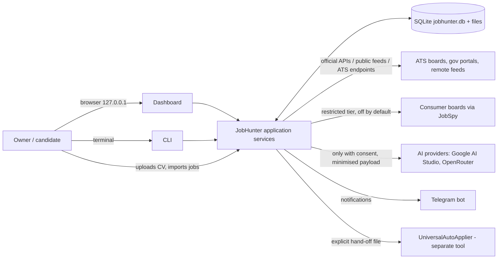
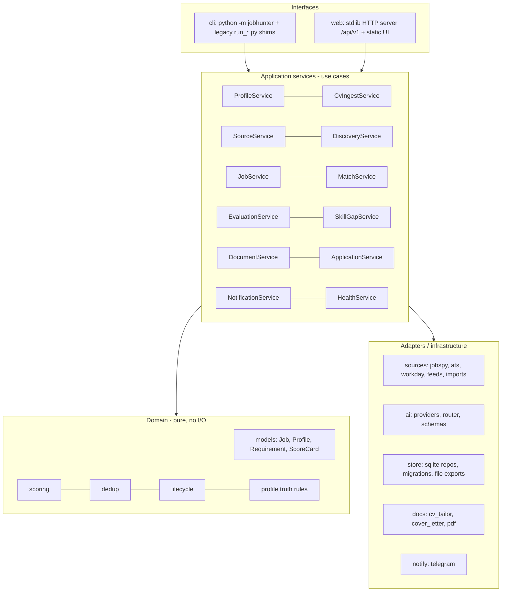
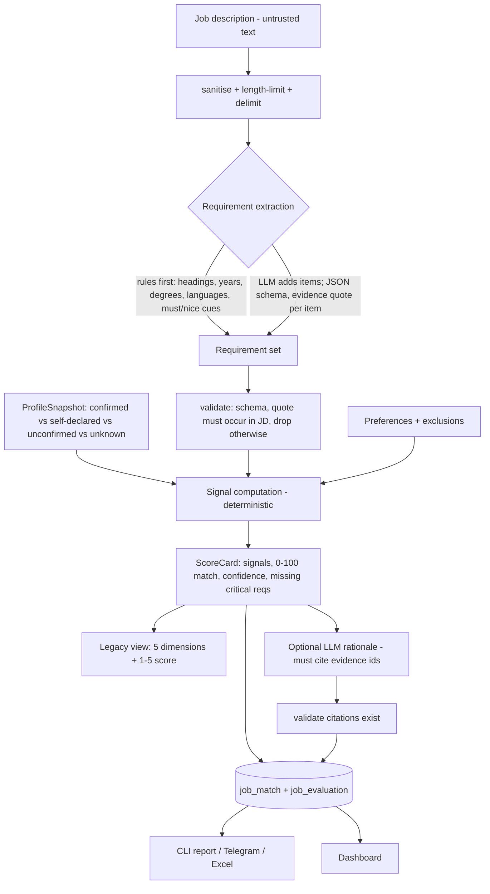
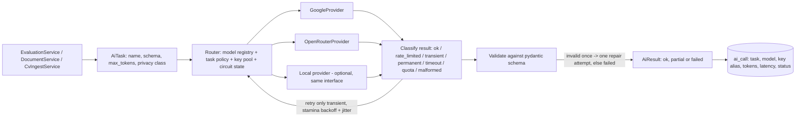
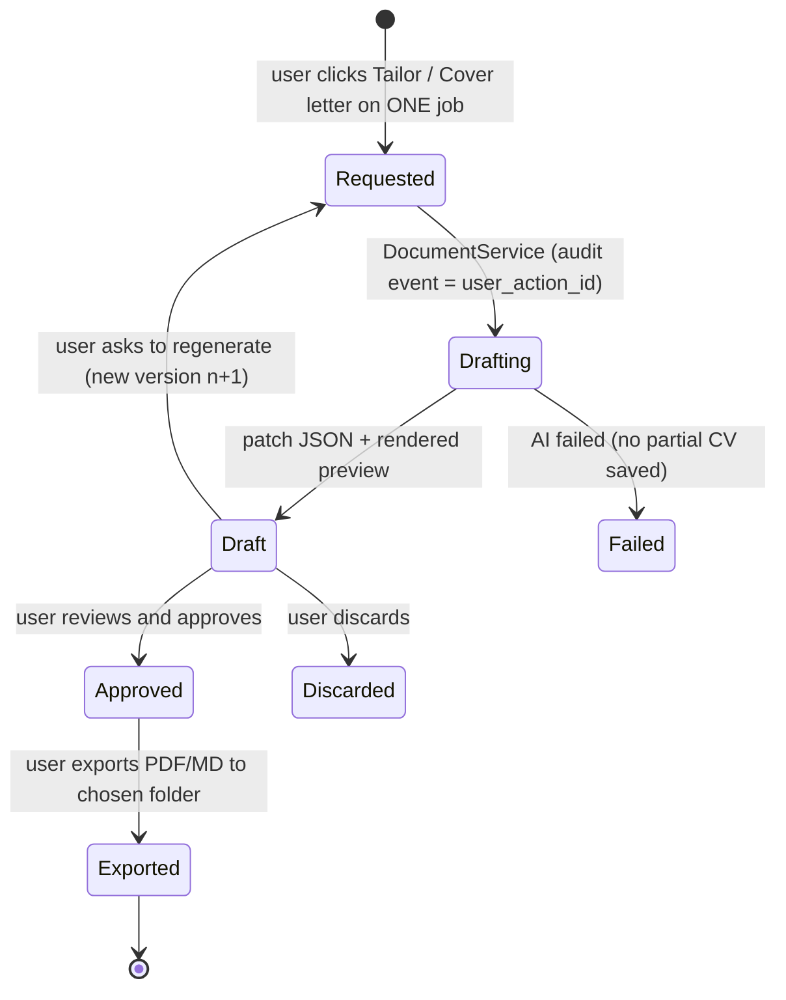
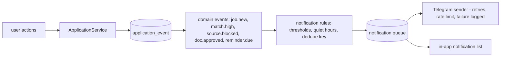
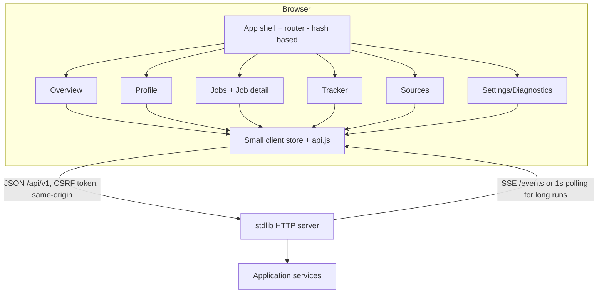
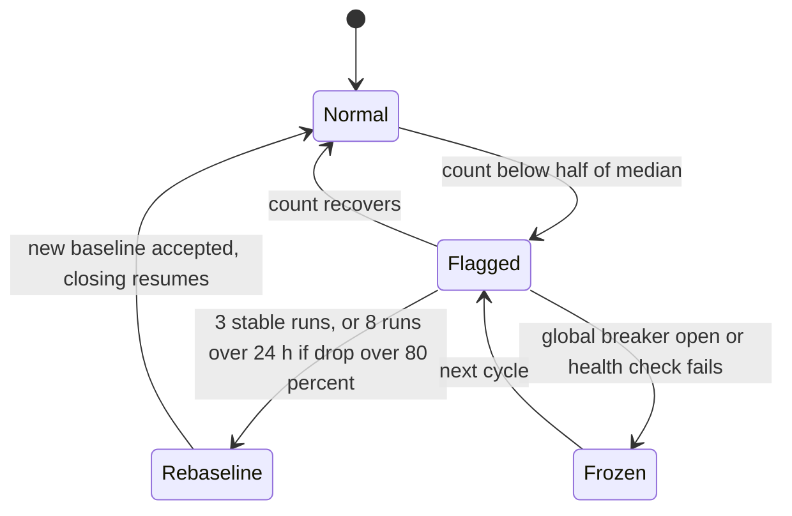

# 03 — Target Architecture

Status: design document, 2026-11-01. Part of [FINAL_SYSTEM_STRATEGY_AND_DESIGN.md](FINAL_SYSTEM_STRATEGY_AND_DESIGN.md).
Data model and contracts: [04](04_DATA_AND_INTEGRATION_DESIGN.md). Screens: [05](05_USER_EXPERIENCE_AND_WORKFLOWS.md).

## 1. Design principles (each traceable to a requirement)

1. **Strangler, not rewrite.** Existing `agents/`, `utils/`, `scanners/` modules stay where they are and are wrapped by services; code moves only when a phase needs it. (brief §3.3 "default is preservation")
2. **One brain, two faces.** CLI and dashboard call the same application services; neither contains business logic. (brief §6.3)
3. **The database is the single source of truth per entity after cutover;** flat files become *exports* (`pipeline.md`, `evaluations.json`, Excel, `application_queue.jsonl`). Before cutover of an entity the files remain the source. Never both at once. (brief §8)
4. **No core capability depends on a restricted source.** Discovery, matching, tracking and documents work with consumer boards switched off. (brief §7.4, RC-2)
5. **A failed step never looks like success.** Failed AI call, partial sync, blocked source = explicit state, never an empty result or invented score. (brief §10)
6. **The user triggers anything that touches their documents.** (brief §5.3)
7. **CPU-only, free-first core; local-first by default.** The same code runs as a single-user local app (SQLite, no service besides the app process) or, from phase P13, as a hosted multi-user platform (PostgreSQL). No GPU assumptions. (brief §12 as amended by [08](08_REVISION_1_PLATFORM_SCOPE_AND_REVIEW_RESPONSE.md) C-4)
8. **Shared corpus, per-user matching.** Job collection and enrichment are user-independent and happen once per job; matching, eligibility, feedback and documents are per user, isolated by `user_id`. (08 §4.1)

## 2. System context



Trust boundaries: everything left of `APP` is local. Arrows to sources/AI/Telegram cross the network; payloads are minimised (doc 06 §5). UAA is a file hand-off, not an API.

## 3. Component architecture and layering



**Layer rules (enforced by a test that parses imports, doc 06 §2):**
- `interfaces/*` may import only `app` and `domain.models` (for typing).
- `domain/*` imports nothing outside `domain` and the standard library (plus pydantic).
- `adapters/*` implement ports declared by `app`; they never import `interfaces`.
- Business rules (score math, dedup thresholds, profile truth, lifecycle) live **only** in `domain`.

Physical layout (new code under one package; legacy folders untouched until wrapped):

```
jobhunter/
  domain/      models.py scoring.py dedup.py lifecycle.py profile_truth.py requirements.py
  app/         profile.py cv_ingest.py sources.py discovery.py jobs.py match.py evaluation.py
               skillgap.py documents.py applications.py notifications.py health.py
  adapters/    sources/{jobspy,ats,workday,feeds,imports,directory}/  ai/  store/  docs/  notify/
  interfaces/  cli/  web/
agents/ utils/ scanners/ run_*.py jobhunter_ui/   # existing; wrapped, then thinned
third_party/                                       # vendored copies of used library modules, only if upstream stalls (OT-19)
```

## 4. Component responsibilities (the 20 domains)

| # | Domain | Module (target) | Responsibility | Inputs → outputs | Data owned | Exists? |
|---|---|---|---|---|---|---|
| 1 | Entry points / orchestration | `interfaces/cli`, `interfaces/web`, `app/*` | parse input, call one service method, render result | args/HTTP → `Result[T]` | none | CLI exists (`run_*.py`); UI exists |
| 2 | Candidate profile | `app/profile.py`, `domain/profile_truth.py` | CRUD, versioning, proficiency semantics, `profile.yml` sync | edits → `ProfileVersion` | `profile_*` tables | partial (`profile.yml`) |
| 3 | CV ingestion/extraction | `app/cv_ingest.py` | store original (immutable), extract draft fields, drive review | file → `cv_document`, `cv_extraction` draft | `cv_document`, `cv_extraction` | partial (`convert_cv_with_ai`) |
| 4 | Source registry | `app/sources.py` | catalogue, policy gate, enable/disable, states, health | config → `source` rows | `source`, `source_run` | partial (`portals.yml`) |
| 5 | Source adapters | `adapters/sources/*` | fetch + normalise per provider via the contract | query+checkpoint → `RawBatch`/`Job` | none (stateless) | partial |
| 6 | Ingestion/normalisation | `app/discovery.py` | run adapters politely, validate, map to `Job`, persist raw + canonical | batches → rows | `raw_job`, `job_sighting` | partial (`bridge.py`) |
| 7 | Dedup & identity | `domain/dedup.py` | 3-stage matching, link creation | `Job` set → links | `job_link` | partial (URL only) |
| 8 | Job storage & lifecycle | `domain/lifecycle.py`, store | new/updated/closed/expired | sync results → status | `job` | no DB |
| 9 | Search & filtering | `app/jobs.py` | filters, saved searches, title/location rules | query → page | `saved_search` | partial (`filters.py`) |
| 10 | Matching | `app/match.py`, `domain/scoring.py` | deterministic signal vector + score | profile + requirements → `ScoreCard` | `job_match` | no (LLM-only today) |
| 11 | AI evaluation | `app/evaluation.py`, `adapters/ai` | requirement extraction + evidence-quoted rationale | JD → structured JSON | `job_evaluation` | yes (evaluator) → refactor |
| 12 | Skill-gap | `app/skillgap.py` | gaps per job and aggregated | requirements × profile → gaps | `skill_gap` | no |
| 13 | Learning recs | `app/skillgap.py` | map recurring gaps to resources (rule-based, optional) | gaps → suggestions | `learning_reco` | no |
| 14 | Application tracking | `app/applications.py` | status machine, events, notes, reminders | user actions → events | `application`, `application_event` | partial |
| 15 | CV tailoring / documents | `app/documents.py`, `adapters/docs` | explicit per-job drafts, review, versions, export | job+profile+base CV → `generated_document` | `generated_document`, files | yes (agents/utils) → wrap |
| 16 | Notifications | `app/notifications.py` | rules → Telegram (later others); dedupe sends | events → messages | `notification` | partial |
| 17 | Analytics/reporting | `app/health.py`, `app/jobs.py` | counts, source yield, funnel; exports (Excel/CSV/queue) | DB → views/files | views only | partial (Excel) |
| 18 | AI routing/model mgmt | `adapters/ai` | provider interface, model registry, error taxonomy, cost log | prompt+schema → validated output | `ai_call` | yes (smart_router) → refactor |
| 19 | Config & secrets | `app/profile.py`, `app/health.py` | `.env` secrets, `config/*.yml`, validation | files → typed settings | files | yes |
| 20 | Logging/observability/health | `app/health.py` | JSONL logs, run records, anomaly checks, diagnostics | events → status | `audit_event`, logs | partial |

**Stays independent:** `domain/*`; each source adapter; `adapters/ai`; `adapters/docs`. **Shared contracts:** `Job` (ingest), `ProfileSnapshot` (matching/documents), `ScoreCard`, `Result[T]`, `SourceAdapter`. **Consolidate:** weights (3 copies → `domain/scoring`), job identity (3 notions → `job.id` + UAA hash kept separate), CV creation call sites (2 → `DocumentService`), ATS/feeds scanners (mine) vs `ats-scrapers`.
Not created as separate services: analytics, learning, notifications — they are modules inside the one process.

## 5. Job discovery architecture

```mermaid
flowchart LR
  REG[Source registry: state + policy gate + throttle] --> SCH[Run planner: queries, checkpoints, cooldowns]
  SCH --> AD[SourceAdapter.discover]
  AD -->|RawBatch + provenance| RAW[(raw_job)]
  RAW --> NORM[normalize to canonical Job + validate]
  NORM --> FIL[global quality rules: language en or de, malformed; hidden with reason, never deleted]
  FIL --> D1[Stage 1: global_id + canonical URL]
  D1 --> D2[Stage 2: company+req id, RapidFuzz]
  D2 --> LIFE[lifecycle + volume guard: new / updated / unchanged]
  LIFE --> JOB[(job + job_sighting + job_link)]
  JOB --> EVT[events: job.new, job.updated]
  EVT --> ENR[Enrich once per job: language, ESCO taxonomy, requirements, eligibility cues, salary]
  ENR --> MATCH[Per-user match + eligibility verdict - doc 03 §6]
  AD -. errors, status codes, counts .-> RUNS[(source_run)]
  RUNS --> HEALTH[health + anomaly detection]
  HEALTH --> REG
```



Key behaviours:
- **Polite scheduler:** per-host semaphore + token bucket from the registry (Ashby 1 req/s, Workable < 8 req/40 s, Workday ~90 req/min global, others default 2 req/s); `stamina` backoff for transient errors only; a **circuit breaker** per source opens on 401/403/429 and keeps the source `blocked` until manually re-enabled or the cool-down expires — no retry-through-evasion.
- **Closure safety:** an adapter reports `coverage` = `complete | partial | unknown` per run. Only `complete` + success lets lifecycle close a job (after 2 consecutive complete misses). All consumer-board runs are `partial` by construction. **Volume guard (Revision 1):** a run whose count is below half of the source scope's recent median is recorded `partial` and closes nothing; a 304 *not modified* response counts every known job as seen (doc 08 §4.9). **Recovery (v2):** after 3 consecutive flagged runs with a stable count the new level becomes the baseline; a drop of more than 80 % or to zero needs 8 runs over ≥ 24 h plus a passing `health_check` and no simultaneous global-breaker trip ([10](10_METHODOLOGY_FEASIBILITY_REVIEW.md) F1).
- **Legacy scanners keep working** during migration: each existing scanner is wrapped as an adapter whose `normalize` maps `JobPosting → Job`. The tested fallback parsers in `scanners/ats.py` stay registered as adapters until the library adapters pass ≥ 4 weeks of live verification (doc 10 F5).
- **Detail fetching is incremental:** adapters with thin list rows (Workday, Greenhouse pay, SmartRecruiters, BambooHR, Breezy, Rippling) consult `source_item_state` and fetch details only for new/changed items.

Source types and how they fit without forcing a scraping model (contract in doc 04 §5):

| Type | Adapter style | Notes |
|---|---|---|
| ATS public JSON/XML | request/response, paged or single payload | primary reliable base |
| Public job APIs/feeds (Remotive, Jobicy, Arbeitnow, Remote OK, WWR) | single payload + cooldown + attribution | attribution text stored per job |
| Government portals (Bundesagentur, EURES) | via `ats-scrapers` adapters, optional | deferred item |
| Consumer boards | JobSpy wrapper, query matrix | restricted, off by default |
| Employer career pages | sitemap + JSON-LD harvester | deferred phase, robots.txt respected |
| Freelance marketplaces, public hiring posts | not built; would use official APIs only | out of current scope |
| User imports / manual jobs | `ImportAdapter`: paste text/URLs, `.eml`/`.mbox` alert emails, Telegram forward, CSV (08 §4.5) | always available, no network |

## 6. Matching and evaluation architecture



**Deterministic vs LLM:**

| Task | Method | Why |
|---|---|---|
| Hard filters, exclusions, location/remote rules, employment type, language level comparison, years/degree thresholds | deterministic | testable, free, no hallucination |
| Skill overlap, coverage, missing critical requirements, seniority gap | deterministic over extracted requirements | explainable |
| Requirement extraction from messy JD text | rules first, LLM to fill gaps, every item needs a verbatim evidence quote that exists in the JD | hallucination control |
| Rationale text (2–3 sentences) | LLM, must reference requirement ids; optional | readability only; never changes the score |
| CV patch, cover letter | LLM, user-initiated only | documents |
| CV field extraction | rules first; LLM optional with consent | privacy |

**Signals** (each normalised to 0–1, with a `known` flag; details and weights in doc 04 §3.4): technical skill coverage (weighted by required vs preferred), proficiency fit, experience relevance, seniority compatibility, education requirement, language requirement vs confirmed levels, location/relocation, remote/on-site preference, employment type, industry relevance, explicit exclusions (veto), missing critical requirements (cap). **Eligibility** (work authorisation, location/nationality restriction, sponsorship, relocation plan) is **not** a signal: it is a separate verdict `eligible | blocked | unknown_check` shown beside the score (08 §4.3). **Salary** is stored and shown as stated but **not scored** (08 §4.4). Seniority is derived from requirements text (years, scope), not from the title.

**Proficiency states** (brief §9.1) and their effect:

| State | Matching | Skill-gap |
|---|---|---|
| `confirmed(level)` | full credit for level fit | gap only if level < required |
| `self_declared(level)` | credit at 0.8 × (configurable) and lowers confidence | shown as "unverified" |
| `extracted_unconfirmed` | credit 0.5 ×, confidence penalty, UI asks to confirm | "confirm to count" |
| `present_level_unknown` | credit 0.6 × | "level unknown — add level" |
| `absent` | 0 credit | gap |

**Score contract:** `match_score` 0–100 (never shown without `confidence` and the top-3 reasons); legacy `score_1_5 = round(1 + 4·match/100, 1)` so thresholds, ranking, Excel and the UAA export keep working; legacy five dimensions are a *view* over signals (mapping in doc 04 §3.4). The model's own total is stored for audit but never used.

## 7. AI infrastructure



- **Provider interface:** `generate(prompt, schema, timeout) -> RawResponse`; providers know nothing about retries.
- **Model registry:** task → ordered candidates (e.g. `extract_requirements`: Google flash-lite → OpenRouter free models). Models come from `profile.yml` today; they move to `config/ai.yml`.
- **Error classes:** `rate_limited` (429, honour `Retry-After`), `transient` (5xx/connection), `timeout`, `quota_exhausted` (daily key limit → key cooldown until next UTC midnight), `permanent` (4xx/auth → never retried; key marked bad), `malformed` (schema failure).
- **Key pool:** per-key cooldown persisted in DB; rotation preserved (RC-9); keys referred to by alias in logs, never printed.
- **Failure semantics:** `failed` → evaluation row `status=failed` with reason, **no score**; `partial` (e.g. requirements extracted but rationale failed) → deterministic score exists, `rationale=null`, UI shows "explanation unavailable". Retried automatically only by explicit user/queue action, with a cap of 3 attempts per job per day.
- **Caching:** key = hash(task, prompt template version, JD text hash, profile snapshot id) → identical request never re-billed.
- **Cost tracking:** tokens and call counts per provider/key/day; free-tier headroom shown in Diagnostics.
- **Local models:** the provider interface admits one; **no GPU assumption**; not on the roadmap until the owner asks.

## 8. CLI and dashboard parity

Both interfaces are thin renderers over `Result[T] = {status, data, errors[], warnings[]}`. CLI prints text or `--json`; HTTP returns the same JSON under `/api/v1`.

| Use case | Service method | CLI (existing flags unchanged) | HTTP | UI screen |
|---|---|---|---|---|
| Scan sources | `DiscoveryService.run(sources, dry_run)` | `run_scan.py [--dry-run]` | `POST /api/v1/runs {kind:"scan"}` | Sources / Jobs "Find jobs" |
| Evaluate jobs | `EvaluationService.run(mode, threshold)` | `run_evaluate.py --next/--all/--url/--batch` | `POST /runs {kind:"evaluate"}` | Jobs |
| Scan + evaluate | `DiscoveryService.run` then `EvaluationService.run` | `run_all.py` | `POST /runs {kind:"all"}` | Overview |
| List/rank jobs | `JobService.list(filters, weights)` | `python -m jobhunter jobs` (new) | `GET /jobs` | Jobs |
| Job detail + explanation | `JobService.detail`, `MatchService.get` | `jobs show <id>` (new) | `GET /jobs/{id}` | Job detail |
| Tailor CV / cover letter | `DocumentService.create_draft(job, kind)` | `run_evaluate.py --url <u> --create-cv` (only with `--url`) | `POST /jobs/{id}/documents` | Job detail → "Tailor CV" |
| Track application | `ApplicationService.set_status` | `jobs status <id> <state>` (new) | `PUT /applications/{id}` | Tracker |
| Export queue | `ApplicationService.export_queue` | `run_export_queue.py` | `POST /exports/queue` | Tracker |
| Source health | `SourceService.health` | `run_health.py`, `run_check_sources.py` | `GET /sources` | Sources |
| Profile | `ProfileService.get/update` | `profile show/edit` (new) | `GET/PUT /profile` | Profile |

Parity guarantees: (1) scripts keep their current flags and exit codes (golden CLI tests); (2) a **parity test** feeds one fixture database through `JobService.list` via both the CLI renderer and the HTTP handler and requires identical ranked ids and scores; (3) the UI never reads `evaluations.json`/`pipeline.md` directly after cutover; (4) no scoring constant exists outside `domain/scoring.py`. Migration path for the current divergence: P2 introduces services over the existing files; P3 switches storage underneath without changing the interfaces.

## 9. User-initiated documents (architecture view)



Invariants (tested): no code path creates a `generated_document` without a `user_action_id`; the original uploaded CV file is stored read-only with its SHA-256 and never rewritten; each draft stores base CV id, profile version id, job id, model, patch JSON and version number; the UAA queue only lists jobs whose documents are `Approved` or `Exported`.

## 10. Notifications and application-tracking flow



Application states: `saved → preparing → ready_to_apply → applied → interview → offer → (accepted | declined)`; terminal side states `rejected`, `withdrawn`, `archived`. Every change is an event with timestamp and optional note, so history and undo come from the log. `ready_to_apply` is the only state that makes a job eligible for the queue export. Telegram messages never contain CV text or contact data (job title, company, score, link only).

## 11. Dashboard/frontend architecture



Decisions: keep the existing **stdlib server and vanilla JS** (no Node build, no new heavy dependency); adopt a versioned JSON API and per-screen modules; long operations (scan, evaluate) are *runs* with ids, progress and cancel; all server-supplied text is rendered as text (existing rule, tested). Re-evaluate FastAPI only if contract tests or async needs justify it (OT-3).

## 12. Observability and health

JSONL structured logs with size rotation; every source run, AI call, notification and document action writes a row; `HealthService` computes: dependency/wheel check, config validity, disk space, DB integrity (`PRAGMA integrity_check`), per-source state, last success, 7-day median volume with anomaly flags (sharp drop/spike), AI key headroom, backup age. The Diagnostics screen and `run_health.py` show the same report. **Anomaly detection:** a per-board robust z-score only for boards with a median of ≥ 20 jobs (denominator floored), the volume guard for smaller boards, and a cohort detector on summed counts per ATS provider and tier (doc 09 B12, doc 10 F2).

## 13. Revision 1 additions (amends §3–§6)

New application services, all inside the one process: `EnrichmentService` (language detection, ESCO taxonomy, requirement/eligibility/salary extraction — runs once per job), `EligibilityService` (per-user verdict), `CompanyCatalogService` (catalog, recognition via the library resolver, multi-channel discovery funnel, careers-page probe — doc 09 §B1–B4, B8), `ImportService` (paste, `.eml/.mbox`, Telegram forward, CSV), `FeedbackService` (events, suggestions, capped soft adjustment), `SchedulerService` (cadences, single-writer lease). Domain additions: `domain/lexicon` (EN/DE data files), `domain/eligibility`, `domain/salary`, `domain/seniority`. Ports are unchanged; hosted mode adds `adapters/store/postgres`, auth and a worker runner (P13–P14). Design detail: [08](08_REVISION_1_PLATFORM_SCOPE_AND_REVIEW_RESPONSE.md) §4.

## 14. Revision 2–3 additions (amend §4–§5, §12)

Methods: [09](09_REVIEW_AND_METHODOLOGY_SPECIFICATION.md) Part B. Evidence and fixes: [10](10_METHODOLOGY_FEASIBILITY_REVIEW.md).

**Discovery funnel as services** (all in-process): `CandidatePool` (URL/domain/name + provenance + TTL) → `Normaliser` (tracking/redirect rejection) → `RecognitionService` (wraps `resolve_careers_url`, adds the policy gate and four outcome classes) → `VerificationService` (one `health_check`, capped first fetch) → `ValueScorer` (value score, tiers A/B/C/dormant, onboarding throttle) → `SchedulerService`. `CompanyCatalogService` owns the `company` entity (domain-first merge, `tldextract` offline, advisory `company_type`). The careers-page probe and JSON-LD recipe are optional adapters added only after their pilots (doc 10 §5).

**Lifecycle guard states (v2).**



**Monitoring split.** `HealthService` runs the volume guard per source scope (all sizes), the robust-z detector per board only at median ≥ 20, and a `CohortMonitor` over provider-level sums. **Library risk.** `adapters/sources/ats` registers two implementations per provider where both exist — the library adapter and the tested fallback parser — and the registry selects by a per-source flag; the fallback is the default until live verification passes. **Capabilities.** `SourceDescriptor` carries `list_complete`, `needs_detail`, `detail_incremental`, `supports_conditional`, `known_cap`, `requires_authorisation`, `policy_blocked`; shared ingestion code never branches on provider names (lint).

