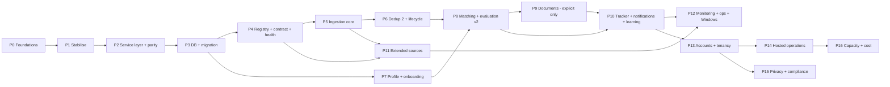

# 07 — Implementation Roadmap

Status: design document, 2026-11-01. Part of [FINAL_SYSTEM_STRATEGY_AND_DESIGN.md](FINAL_SYSTEM_STRATEGY_AND_DESIGN.md).
Each phase is one or two working sessions under the contract in `docs/PROMPT.md` (read-only first, one stage per branch, full tests after each commit, report format §6). Size: S ≤ 1 session, M ≈ 2, L ≈ 3 (estimates, not commitments).

## 1. Sequence and why

Order follows the brief's priorities — (1) correctness of what exists, (2) shared architecture, (3) data integrity, (4) reliable sources, (5) matching consistency, (6) onboarding, (7) user-facing workflow, (8) more sources — with **one justified deviation**: profile/onboarding (**P7**) comes before matching (**P8**) because the matcher consumes proficiency *states* that only the new profile model provides.

## 2. Phase summary (authoritative numbering)

| Phase | Name | Size | Depends on | Verifiable improvement |
|---|---|---|---|---|
| P0 | Foundations & guardrails | S | — | reproducible install, policy tests, PII-safe config |
| P1 | Stabilise existing behaviour | M | P0 | known defects DEF-01/02/03/04/05/06/07 closed |
| P2 | Shared service layer + CLI/UI parity | M | P1 | one code path for both interfaces |
| P3 | Canonical data, SQLite, migration | L | P2 | DB authoritative, exports byte-identical |
| P4 | Source registry, adapter contract, health | M | P3 | honest source states + run history |
| P5 | Ingestion core (5a JobSpy wrapper, 5b ATS + directory + Stage 1) | L | P4 | ATS + consumer ingestion into canonical `Job` |
| P6 | Dedup stage 2 + lifecycle | M | P5 | cross-source duplicates linked, closed/updated tracked |
| P7 | Candidate profile + onboarding (manual + CV-assisted) | L | P3 | confirmed-profile model with proficiency states |
| P8 | Matching & evaluation v2, skill gaps | L | P6, P7 | explainable deterministic scores; AI failure semantics |
| P9 | User-initiated documents | M | P8 | per-job draft/review/approve/export, versioned |
| P10 | Tracker, notifications, learning | M | P8, P9 | events, reminders, Telegram rules, gap resources |
| P11 | Extended sources: Workday/ATS patches, regional, remote, government | L (per-source mini-phases) | P5, P4 | more sources through the controlled-expansion process |
| P12 | Monitoring, operations, Windows packaging, docs | M | P10, P11 | anomaly alerts, backups, one-page install |
| P13 | Accounts, auth, tenancy (hosted mode) | L | P10 | per-user isolation proven by tests |
| P14 | Hosted operations (PostgreSQL, workers, storage, inbound email) | L | P13 | hosted instance runs the shared ingestion plane |
| P15 | Privacy, compliance, source redistribution | M | P13 | consent, export/delete, per-source redistribution gating |
| P16 | Capacity and cost controls | M | P14 | per-user budgets, scope-driven ingestion limits |

## 3. Phase details

Common rollback: each phase lives on its own branch/tag (`phase-Pn`); schema changes are additive; authority flags (doc 04 §1.1) can be flipped back; legacy files are never deleted.

### P0 — Foundations & guardrails
| Field | Detail |
|---|---|
| Objective | Make the project installable and rule-checked before any behaviour changes. |
| Existing reusable | `requirements.txt`, test suite (286), `docs/PROMPT.md` contract, `.gitignore` |
| Required changes | `pyproject.toml` + hash-locked lock files per dependency group; pins from D7 (all verified to exist); `certifi>=2026.10.19`; `profile.example.yml` + move real `config/profile.yml` out of tracked files; `.gitignore` for `data/ output/ .env cv*`; secrets/PII scan check |
| New components | `tests/test_policy_blocked.py` (G3), `scripts/verify_windows.ps1`, CI workflow (Linux + `windows-latest`) with WeasyPrint present |
| Dependencies | none |
| Deliverables | lock files, policy test, CI config, verify script, updated README install section |
| Acceptance | clean-venv install from lock on Windows and Linux succeeds; 286 tests pass with **0 skipped**; policy test fails when `selenium` is added to a test lock; secret scan finds nothing in tracked files |
| Tests | policy, install smoke, PII scan |
| Risks | Windows wheel gaps for a future patch version; WeasyPrint/GTK on Windows (OT-10) |
| Rollback | revert branch; no runtime change |

### P1 — Stabilise existing behaviour
| Field | Detail |
|---|---|
| Objective | Fix the defects that contradict approved decisions or hide failures. |
| Existing reusable | `run_evaluate.py`, `evaluator.py`, `smart_router.py`, `bridge.py`, `scanners/ats.py`, `jobspy_scanner.py` |
| Required changes | **DEF-01** remove automatic CV/PDF path (`create_cv`/threshold logic in `run_evaluate.py:298-343`), `--create-cv` only with `--url`; **DEF-02** evaluator prompt reads languages/preferences from the profile (needs OT-5 answer; until then states "level unconfirmed" instead of C1 claims); **DEF-03** recompute total from weights in one function, ignore model total; **DEF-04** atomic writes in `bridge.py`; **DEF-05** `policy=disabled_by_policy` + `authorized` flag for SmartRecruiters; **DEF-06** delete or implement `pages`; **DEF-07** error taxonomy + jitter + key cooldown in the router; failed AI call → no score |
| New components | `domain/scoring.py` (first function), `AiErrorClass`, tests for each fix |
| Dependencies | P0 |
| Deliverables | patches + tests; changelog listing every behaviour change |
| Acceptance | tests: (a) `run_evaluate --all` with `create_cv: true` creates **no** document; (b) mocked 429/5xx/4xx/timeout/malformed each take the specified path, exhaustion returns `failed` with no score; (c) crash-injection test leaves `pipeline.md` intact; (d) SmartRecruiters board without `authorized` is skipped with a visible reason; (e) all 286 original tests still pass (any changed test justified in writing) |
| Tests | new unit + mocked-provider tests; golden CLI flags |
| Risks | behaviour change for users relying on auto-CV; model prompt change alters scores |
| Rollback | per-fix commits, revertable individually |

### P2 — Shared service layer + CLI/UI parity
| Field | Detail |
|---|---|
| Objective | Remove duplicated business logic; make both interfaces render the same `Result[T]`. |
| Existing reusable | `jobhunter_ui/service.py` (`Workspace`), `ranking.py`, `run_*.py` |
| Required changes | introduce `jobhunter/app/*` services *over the existing files*; `run_*.py` become thin shims (same flags, exit codes); UI handlers call services; `ranking.py` → `domain/scoring` |
| New components | `jobhunter/domain`, `jobhunter/app`, layer-lint test, parity test, `python -m jobhunter jobs/profile/health` |
| Dependencies | P1 |
| Deliverables | package skeleton, services for jobs/evaluation/documents/applications/health, golden CLI tests |
| Acceptance | parity test: one fixture workspace → identical ids and scores via CLI renderer and HTTP; layer test green; no weight constants outside `domain/scoring.py` (grep test) |
| Tests | G4, parity, CLI golden, existing UI tests |
| Risks | refactor regressions in UI; mitigated by 37 existing UI tests |
| Rollback | shims keep old call paths; revert branch |

### P3 — Canonical data, SQLite, migration
| Field | Detail |
|---|---|
| Objective | One authoritative store with provenance, additive migrations and compat exports. |
| Existing reusable | `evaluation_store` shape, `queue_exporter` (unchanged), reference rewrite's migration pattern |
| Required changes | add DB + migrations 0001…; importers (profile.yml, pipeline.md, scan-history, jd_cache, evaluations.json, app_state.json, applications.md); export writers regenerate legacy files; `Job` model adopted (`legacy_to_job`) |
| New components | `adapters/store/*`, `migrations/`, `ImportService`, verifier, backup service |
| Dependencies | P2 |
| Deliverables | schema (doc 04 §4), importers, exporters, `python -m jobhunter migrate/verify` |
| Acceptance | on a copy of the owner's real workspace: counts equal, URL sets equal, `application_id` equal for all exportable jobs, **queue file byte-identical**, importer re-run is a no-op, rollback flag restores file authority |
| Tests | migration suite, golden export, crash-during-migration test |
| Risks | data loss (mitigated: backup + no deletes); `global_id` for legacy rows |
| Rollback | authority flag → `file`; restore backup zip |

### P4 — Source registry, adapter contract, health
| Field | Detail |
|---|---|
| Objective | Honest, observable sources. |
| Existing reusable | `portals.yml`, `net.py` (host allow-list, cooldown), `run_check_sources.py`, scanners |
| Required changes | `source`, `source_run`, `source_item_state` tables; registry service with states and policy gate; wrap each existing scanner as an adapter (`normalize` = `JobPosting→Job`); circuit breaker; per-host throttle; telemetry for Conflict 3 |
| New components | `SourceAdapter` protocol, `RunContext`, Sources screen, `sources check` CLI |
| Dependencies | P3 |
| Deliverables | contract + parity fixtures (reuse the 24 extra-source tests), UI/CLI health |
| Acceptance | state machine tests; single mocked 429 opens breaker and no further request is issued; run recorded with `coverage`; "0 jobs" always carries a reason; no consumer-board run can set `coverage=complete` |
| Tests | contract suite, breaker, state transitions |
| Risks | over-engineering the registry — keep to fields in doc 04 §5.1 |
| Rollback | adapters still callable through old scanners |

### P5 — Ingestion core (5a, 5b)
| Field | Detail |
|---|---|
| Objective | D1/D2/D6/D10 + Stage 1 of D4. |
| **5a JobSpy wrapper** | capture `attrs["errors"/"warnings"]`; map 34-col frame → `Job` (column list must be **verified against 1.4.1 first**); `QueryMatrix` partitioning (term × city × date window); `LinkedInQueryPlanner` (filter→keyword, `matched_search_term`, 3–7 s jitter); raise `jobspy>=1.4.1`, `certifi` floor; all consumer providers default off, owner acknowledgement per provider |
| **5b ATS + directory + Stage 1** | install `ats-scrapers==0.3.0` (+ bs4/html2text, no `[all]`); `AtsAdapterBase`; allow-list Greenhouse, Lever, Ashby, Recruitee, Rippling first; vendor `ats-directory` snapshot (CC0, checksum, date); probe order Greenhouse→Lever→Ashby→Recruitee; SmartRecruiters `totalFound:0` = not found; Stage 1 dedup (`global_id`, `w3lib` canonical URL); **keep `scanners/ats.py` as the tested fallback** until the library adapters pass live verification for ≥ 4 weeks (doc 10 F5) |
| Existing reusable | `jobspy_scanner.py`, `ats.py` parsers as fixtures, `feeds.py` rules |
| Dependencies | P4 |
| Deliverables | adapters, fixtures, "Add watch company" flow, ingest integration test |
| Acceptance | **offline:** fixtures for each allow-listed adapter normalise to valid `Job` with deterministic `global_id`; mocked JobSpy error → failed run; matrix of 3×2 → 6 queries; planner makes no network call; **on the owner's machine (live, to be recorded with date):** one Greenhouse, one Lever, one Ashby board, one Recruitee board and each enabled remote feed return > 0 jobs; consumer providers verified one at a time for Egypt/Oman/UAE/Germany queries (research item 2–3) |
| Tests | adapter contract, ingest integration, policy test (blocked adapters cannot be enabled) |
| Risks | live behaviour differs from fixtures; LinkedIn 429; `ats-scrapers` schema drift on upgrade |
| Rollback | disable source rows; old scanners remain until parity proven |

### P6 — Dedup stage 2 and lifecycle (Stage 3 deferred by owner)
| Field | Detail |
|---|---|
| Objective | D4 complete. |
| Required changes | Stage 2 (company+req id, RapidFuzz), exact `description_hash` linking (Stage 3 MinHash deferred), volume-guard rules, lifecycle new/updated/closed with `coverage` rules, review queue UI, remembered rejections |
| New components | `domain/dedup`, `domain/lifecycle`, "Possible duplicates" screen |
| Dependencies | P5 |
| Acceptance | golden sets: same job on ATS + 2 boards → 1 job, 3 sightings; repost under a new id with an identical description → `possible_repost` link via `description_hash`, both kept; a volume-guard run closes nothing; multi-location job handled; partial/failed/blocked runs → **zero** `closed`; 2 consecutive complete misses → `closed`; reappearance → `active` |
| Tests | golden duplicate corpus (≥ 30 pairs incl. hard negatives), lifecycle matrix |
| Risks | false merges — mitigated by link-only for stage 3 and human queue; threshold tuning |
| Rollback | links are reversible; no deletes |

### P7 — Candidate profile + onboarding
| Field | Detail |
|---|---|
| Objective | Doc 04 §3 and doc 05 §2. |
| Required changes | profile tables/versioning; yml import review; manual wizard; CV upload + rule-based extraction + review UI; optional AI extraction with per-use consent; proficiency states; duplicate-free sync rules |
| New components | `ProfileService`, `CvIngestService`, upload validator, Profile screen |
| Dependencies | P3 (and OT-5 answer, OT-8 decision) |
| Acceptance | yml import produces **no** `confirmed` rows; extraction output only `extracted_unconfirmed`; rejected fields never reach the profile; every edit = new version, revert works; upload of wrong-type/oversized/ spoofed-extension files rejected; no contact field in any AI payload (payload-capture test) |
| Tests | profile, extraction goldens (≥ 10 sample CVs, synthetic), upload security |
| Risks | PDF extraction quality; new dependency approval (OT-8) |
| Rollback | profile versions; yml still exportable |

### P8 — Matching & evaluation v2, skill gaps
| Field | Detail |
|---|---|
| Objective | Doc 03 §6–7. |
| Required changes | requirement extraction (rules + LLM with evidence quotes), deterministic signals, `ScoreCard`, confidence, legacy 1–5 and dimension views, skill-gap computation, AI failure semantics, caching, `ai_call`/key state tables; evaluator refactored — not duplicated |
| New components | `domain/requirements`, `MatchService`, `EvaluationService`, `SkillGapService` |
| Dependencies | P6, P7 |
| Acceptance | staged labelled set (≈ 60 postings first, marked directional, grown with use): required-skill recall and verdict agreement recorded as a baseline (targets set after it); every displayed requirement has a quote found in the JD; unknown/unconfirmed proficiency produces the credits and flags in doc 03 §6; CLI = UI parity test; AI-off run still ranks jobs; failed AI → `failed` row, no score; legacy exports unchanged for default weights |
| Tests | per-signal, proficiency table, quote validation, error-class matrix, parity |
| Risks | free-tier models produce weak extraction; mitigated by rules-first and validation |
| Rollback | scorer version stamped on each match; stale flags; old evaluator output retained |

### P9 — User-initiated documents
| Field | Detail |
|---|---|
| Objective | Doc 05 §5. |
| Required changes | `DocumentService` wraps `CVTailor`/`CoverLetterWriter`/`pdf_generator`; draft→review→approve→export; versioning; facts check; DB constraint `requested_by_action NOT NULL`; remove remaining implicit callers |
| Dependencies | P8 |
| Acceptance | call-graph test: only `DocumentService.create_draft` reaches tailor/PDF code and only from an endpoint/command carrying a user action; scans/evaluations/imports leave `generated_document` empty (test); original CV hash unchanged after any flow; protected-field edits rejected; queue export lists only approved/exported docs |
| Tests | G5, versioning, diff/revert, export |
| Risks | WeasyPrint on Windows (OT-10) |
| Rollback | feature flag off → no document creation possible |

### P10 — Tracker, notifications, learning
| Field | Detail |
|---|---|
| Required changes | status machine + events + undo; reminders; notification rules/dedupe/quiet hours; Telegram payload without PII; rule-based learning suggestions for recurring gaps; queue export from DB view |
| Dependencies | P8, P9 |
| Acceptance | invalid transitions rejected; undo restores previous state from events; same event never notified twice (dedupe key); payload scan finds no contact/CV text; export byte-identical to golden for the same inputs |
| Tests | status machine, notification dedupe, PII scan, export golden |
| Risks | scope creep in learning content — keep to a small curated list |
| Rollback | notification kill-switch; events are append-only |

### P11 — Extended sources (each source = one mini-phase through doc 04 §5.2)
Order: **Recruitee fallback (before 2027-02-10)** → Greenhouse pay enrichment → Workday adapter (verify facet splitting live, add `source_item_state` + global limiter) → Personio/Teamtailor (`pydantic-xml`) → Workable (shortcode grouping, rate cap, v3 fallback) → Rippling/Breezy/BambooHR verification → Bundesagentur/EURES → remote feeds consolidation (Remotive, Jobicy, Arbeitnow; Rise if attribution accepted) → regional JobSpy providers (Bayt etc.) → optional sitemap + JSON-LD harvester (`extruct`) → optional `crawlee` fallback (only if a needed source has no other route).
Acceptance per source: fixtures + contract tests, one passing canary run (promotion rule simplified by the owner — no multi-day or yield-window criteria), live evidence recorded in `docs/SOURCE_VERIFICATION.md` with date. Recruitee: ladder JSON→XML→`data-props` demonstrated by fixtures. Risks: API drift; per-source terms. Rollback: disable the source row.

### P12 — Monitoring, operations, Windows packaging
| Field | Detail |
|---|---|
| Required changes | volume anomaly detection (7-day median), HTTP status distribution, rotating JSONL logs, backups/restore UI, "Delete my data", Task Scheduler recipe, Windows install README tested on a clean machine, performance benchmarks |
| Acceptance | injected volume drop raises a `degraded` state and an Overview alert; restore from backup verified by integrity check; clean Windows machine install in ≤ 10 documented steps; benchmark results recorded against doc 06 §7 targets |
| Risks | machine-specific issues; mitigate with `verify_windows.ps1` |

## 4. Mapping of the Decision Log's "first 10 days" to phases

| Log step | Phase |
|---|---|
| Day 1 lock dependency stack | P0 |
| Day 2 canonical data contract | P3 (model adopted), P5 (used) |
| Days 3–5 JobSpy wrapper | P5a |
| Days 6–8 ATS adapters + directory + probe order | P5b |
| Days 9–10 Stage 1 dedup | P5b |
| Workday/ATS traps (D3/D5) | P11 |
| Stage 2/3 dedup, lifecycle (D4) | P6 |

## 5. Revision 1 deltas (authoritative where they differ from §3)

Source of each item: [08](08_REVISION_1_PLATFORM_SCOPE_AND_REVIEW_RESPONSE.md). Phases keep their numbers; sub-phases are added instead of renumbering.

| Phase | Added | Removed / changed |
|---|---|---|
| **P0** | live source probe: run `run_check_sources.py` on the owner's machine and record dated OK/FAIL in `docs/SOURCE_VERIFICATION.md` (informational only, C-1); lexicon file skeletons `lexicon/en.yml`, `lexicon/de.yml` | — |
| **P1** | fix DEF-13 test first (red) so the substring bug is pinned; no behaviour change to filters yet | — |
| **P2** | **scheduler**: `jobhunter worker`, per-source cadences (ATS 3 h, government 6 h, feeds per cooldown, consumer boards manual), single-writer lease (lock file until P3, `scheduler_lease` after) | — |
| **P3** | schema §10 of doc 04 from the first migration: `user_id` everywhere, `job_version`, `job_salary`, `job_eligibility(+verdict)`, `company`, `job_feedback`, `import_item`, `scheduler_lease`, `source_http_cache`, `visibility/language/seniority/role_family` | PostgreSQL parity tests added for the migration suite |
| **P4** | conditional requests (ETag / If-Modified-Since, 304 = not modified), run-level volume guard, redistribution flag, connector-registry lint, yield display | **promotion rules removed** (simplified rule) |
| **P5** | **5c Company catalog**: `company` table, ATS recognition via the library resolver `resolve_careers_url` plus JobHunter policy gate (doc 09 §B2; no endpoint is ever guessed), apply-link harvester, seeds (directory snapshot, watch-list); **5d Imports**: paste, `.eml/.mbox`, Telegram forward, CSV; filters become visibility + per-user query-time rules (DEF-13) | — |
| **P6** | lifecycle with volume guard and `job_version`; exact-hash repost linking | **Stage 3 MinHash and `datasketch` deferred** |
| **P7** | eligibility profile (authorisation, nationality, relocation, remote constraints); defaults-first onboarding (three questions, auto-accept with undo, one AI consent setting) | mandatory review screens removed |
| **P8** | `EnrichmentService`: language detection (stdlib), EN/DE lexicon, ESCO taxonomy + open skill vocabulary, seniority from requirements, eligibility extraction + per-user verdict, salary parse (stored, not scored) | — |
| **P10** | feedback loop (events, suggestions, capped adjustment, calibration view) | — |
| **P11** | order: Recruitee fallback → **Bundesagentur and EURES** (German coverage; adapters exist; Bundesagentur caps at 10,000 results per query so queries are partitioned by region/occupation/date) → Workable → Personio/Teamtailor → Workday → Greenhouse pay → others; adaptive cadence (optional) | consumer-board regional providers only in local mode |
| **P12** | monitoring as designed | — |

### P13 — Accounts, authentication, tenancy
| Field | Detail |
|---|---|
| Objective | Hosted multi-user mode with provable isolation. |
| Existing reusable | `user_id` columns from P3; service layer from P2; repository layer |
| Required changes | every repository method takes a user context; auth (email + provider login) and sessions; per-user storage namespaces; PostgreSQL adapter and migration parity |
| Dependencies | P10 (core features done), OT-12 decision |
| Deliverables | auth module, tenant-scoped repositories, isolation test suite, admin-less data access rule |
| Acceptance | automated test enumerates every per-user repository method and proves user A cannot read/write user B rows; deletion of an account removes all its rows and files; local single-user mode still passes the full suite |
| Risks | missed query without a user filter; session/CSRF mistakes |
| Rollback | hosted mode behind a flag; local mode unaffected |

### P14 — Hosted operations
| Field | Detail |
|---|---|
| Objective | Run the shared ingestion plane and per-user plane as a service. |
| Required changes | worker processes for scheduled ingestion, PostgreSQL, object storage for CV files, per-user inbound email address for alert forwarding, monitoring and alerting, encrypted backups, deployment recipe |
| Dependencies | P13, OT-13 (budget/hosting) |
| Acceptance | a staging environment ingests demand-driven scopes on schedule with one active scheduler lease; restore from backup verified; inbound email lands in the right user's imports only |
| Risks | hosting cost; operational load for a single maintainer |
| Rollback | service can be stopped without data loss; local mode remains |

### P15 — Privacy, compliance, source redistribution
| Field | Detail |
|---|---|
| Objective | Make hosted use lawful and transparent. |
| Required changes | consent records, privacy notice, data export and deletion, processor agreements and data-location choice for AI providers, per-source `redistribution` review (Remotive/Remote OK/Arbeitnow terms, Bundesagentur, EURES, ESCO terms), consumer-board tier disabled in hosted mode, retention enforcement |
| Dependencies | P13; OT-13, OT-14 |
| Acceptance | `personal_only` and consumer-board data never appear in a hosted user's corpus view (test); export bundle contains all of a user's data; deletion verified by test; every source row has a recorded terms review date |
| Risks | provider terms forbid hosted redistribution for a needed source (then it becomes link-only or is dropped) |
| Rollback | per-source switch to `link_only` or `disabled` |

### P16 — Capacity and cost controls
| Field | Detail |
|---|---|
| Objective | Keep cost and load bounded as users grow. |
| Required changes | scope-driven ingestion limits (union of active user scopes, caps per country/occupation), per-user AI budgets and rate limits, enrichment cache, storage retention jobs, load tests |
| Dependencies | P14 |
| Acceptance | ingestion volume tracks active scopes (inactive scopes paused); a user over budget gets deterministic matching only, never an error; load test at target concurrency meets measured latency targets set after the first baseline |
| Risks | free-tier AI limits are unusable for many users (OT-13) |
| Rollback | per-user budget switches |

## 6. Revision 2 deltas — methodologies (authoritative; from [09](09_REVIEW_AND_METHODOLOGY_SPECIFICATION.md))

Each row names the methodology section that defines *how*, so no phase has to reinterpret it.

| Phase | Added work (methodology) | Added acceptance |
|---|---|---|
| **P0** | the live probe also records, per aggregator provider, which link fields are actually populated (Indeed, ZipRecruiter, Glassdoor, BDJobs, Naukri, LinkedIn) on a handful of queries; informational baseline for B13 | dated table in `docs/SOURCE_VERIFICATION.md` |
| **P4** | connector **capability registry** and provider-branching lint (B8); global and per-host request budgets (B5); metrics collection per run (B12); cap-detection and coverage validation, small-source confirmation, global cycle breaker (B6); payload-hash short-circuit (B7) | budget never exceeded in a 24 h simulation; capped-list, outage and cycle-breaker fixtures pass; savings reported per source |
| **P5a** | `ProviderEnvelope`: keep `job_url_direct`, `company_url`, `company_url_direct`; never store `emails` (B1 C4, DEF-15) | envelope test; LinkedIn rows documented as yielding no harvest links |
| **P5c** | discovery funnel channels C1, C4, C5; normalisation and tracking/redirect rejection; recognition via the library resolver with policy gate and four outcome classes; verification probe; entity resolution and agency typing; value score, tiers and cold-start rule (B1–B5); weekly funnel table (B13) | recognition fixtures; merge/undo and agency fixtures; tier boundary tests; funnel table generated from a fixture run |
| **P6** | consolidated lifecycle rules (B6); `job_version` and content hash (B7) | disappear/reappear, URL-change and zero-result fixtures |
| **P8** | enrichment pipeline exactly as B10 (language scoring, sectioning, ESCO matching ladder, seniority evidence vote with override rule, years regexes, salary parsing, labelled evaluation protocol across ≥ 10 occupation families) | seniority regression set; labelled-set report with baseline numbers recorded |
| **P11** | connectors per the B8 table, reordered by measured `recognized_unsupported` counts after the baseline; careers-page probe (C6) and JSON-LD recipe (B9) after the baseline, with robots/budget tests | per-connector acceptance rows; probe never exceeds 5 requests/domain/30 days |
| **P12** | adaptive cadence formula (B11); robust-z drift detector and alert actions (B12); channel kill switch (B13) | schedule formula table test; injected-drop test raises `degraded` |
| **After OT-17** | passive datasets: **Common Crawl** URL index as channel C7 (Certificate Transparency demoted — wildcard certificates hide tenants, doc 10 F7), only after a proof-of-concept scored against the 1,804-row directory (recall, precision) | not scheduled until OT-17 is resolved |

## 7. Revision 3 deltas — feasibility (authoritative; from [10](10_METHODOLOGY_FEASIBILITY_REVIEW.md))

**Release R1 (Minimum Viable Methodology)** — the first usable release consists of: P0 (incl. dated live probe), P1, P2 (scheduler + lease), **P3 (database, importers, compat exports — prerequisite of the P4 tables)**, P4 (registry, budgets, **guard v2**, cycle breaker, run metrics), P5a (envelope), P5b (directory + imports; Greenhouse/Lever/Ashby via the **existing tested parsers**), **P5c-lite** (normalise → resolver → policy gate → verification → static tiers A/B/C), P6 (lifecycle with guard), **P8-lite** (language policy, years/seniority with the F3 rules, eligibility cues, salary text, open-vocabulary skills). Everything else in doc 09 is **deferred behind a pilot with a kill criterion** (doc 10 §5). **Estimate [arithmetic from the S/M/L sizes]:** P0 1 + P1 2 + P2 2 + P3 3 + P4 2 + P5 (5a, 5b, 5c-lite) 2.5 + P6 2 + P8-lite 1.5 ≈ **16 sessions**.

| Phase | Change | Added acceptance |
|---|---|---|
| **P4** | guard v2 with the >80 % / zero safety clause; per-board drift only for median ≥ 20, cohort counts for the rest; onboarding throttle (≤ 20 new boards/day) | `docs/feasibility/exp3_guard_sim.py` rules converted into tests: real 60 % drop re-baselines within 3 stable runs; **stable zero outage never re-baselines** (new fixture); floored detector false-alarm rate < 1 % on the small-board simulation |
| **P5b** | keep `scanners/ats.py` as fallback until library adapters pass ≥ 4 weeks of live verification; pin and hash `ats-scrapers` and `python-jobspy`; contract tests on `JobPost.model_fields` (34) and `attrs["errors"]` | contract tests green on every upgrade |
| **P5c** | resolver wrapped with policy gate; `tldextract` offline for company domains (OT-18); agency flag advisory | `exp1_resolver.py` becomes a permanent fixture table (34 cases + new ones) |
| **P8** | seniority, years and language rules exactly as doc 09 B10 after F3/F4; labelled sets staged (≈ 60 / 40 / 50 / 50 first, marked directional) | `exp2_enrichment.py` cases become unit tests (35 passing today); labelled-set report with baseline numbers |
| **P11** | careers-page probe: 100-domain pilot first; Common Crawl: recall measured against the directory | kill criteria recorded in `docs/SOURCE_VERIFICATION.md` |
| **P12** | cohort drift detector with its own simulation; adaptive cadence only if it saves ≥ 20 % requests in replay [target] | simulation test; replay report |

## 8. Effort and release plan (estimates, not commitments)

| Release | Contents | Sessions [arithmetic] |
|---|---|---|
| **R1** usable discovery for one user | P0–P6 core (incl. P3 database), P5a/5b/5c-lite, P8-lite | ≈ 16 |
| **R2** personal workbench | rest of P8, P7 profile + onboarding, P9 documents, P10 tracker/notifications/feedback | ≈ 9–10 |
| **R3** breadth and operations | P11 connectors (per-source mini-phases) and optional pilots (careers probe, Common Crawl), P12 monitoring/ops | ≈ 5–8 |
| **R4** hosted platform | P13–P16 | ≈ 10 |
| **Total** | | **≈ 40–45** |

Each release ends with a dated verification note (what ran live, what did not). Deferred methods enter only when their pilot meets its kill criterion (doc 10 §5).

