# 08 — Revision 1: Platform Scope, Review Response and Comparison Findings

Date: 2026-11-02 · Amends [FINAL_SYSTEM_STRATEGY_AND_DESIGN.md](FINAL_SYSTEM_STRATEGY_AND_DESIGN.md) and docs 02–07. Where this document and an older one disagree, **this document wins** and the older text has been patched (section 9 lists every patch). **Later amendments:** §4.2 (seniority, language policy), §4.8 (recognizer, harvester) and §4.9 (volume guard) are refined by [09](09_REVIEW_AND_METHODOLOGY_SPECIFICATION.md) and [10](10_METHODOLOGY_FEASIBILITY_REVIEW.md); where they differ, the later document wins (list in §10).
Design and documentation only; no code or configuration was changed.

## 1. What changed

| Before | Now (owner instruction) |
|---|---|
| One user, local Windows machine, free-first | **A platform for any user, in any country.** The same code still runs locally for one user; a hosted multi-user mode is added as a staged track (P13–P16). |
| Job languages: English, German, Arabic | **English and German only.** Arabic postings, Arabic lexicon and RTL work are removed. |
| Tech-oriented defaults (title filter, skill vocabulary) | **Profession-agnostic.** No tech-only filter, vocabulary or taxonomy anywhere in the model (interpretation of "ignore the Tech-only filter part"; see 2.3). |
| Per-user filters applied at ingest | Ingestion builds a **shared, unfiltered corpus**; user filters apply at query time and never delete anything. |

## 2. Instruction ledger — every instruction and its disposition

### 2.1 Applied

| # | Instruction | Where it lands |
|---|---|---|
| A1 | Platform, any user, all countries; jobs in English and German | 4.1, 4.2, P13–P16, OT-12/13/14 |
| A2 | Remove Arabic postings | removed from lexicon scope (4.2), doc 05 §6 (RTL), doc 01 evidence left as history |
| A3 | Follow the comparison; add its key weak points to the plan | section 5 (table) and doc 07 deltas |
| A4 | Solve red-team 1.4 (too much review work) | 4.6 |
| A5 | Volume sanity guard: a run with far fewer jobs than the recent median is `partial`, closes nothing | 4.9, doc 04 §6, P4/P6 |
| A6 | Eligibility group: user work authorisation by country, location restriction, sponsorship extracted from postings, hard-filter or "unknown, check", relocation plan "and so on" | 4.3, doc 03 §6, doc 04, doc 05, P7/P8 |
| A7 | Solve 3.3: hiring that travels via LinkedIn posts, messaging groups, emails → fold into the import source type | 4.5, P5d |
| A8 | Salary stored as stated with currency, shown, **not scored** until the owner defines it | 4.4, OT-15 |
| A9 | Remove/defer Stage 3 MinHash + `datasketch` | 4.12; D4 amended in doc 02 |
| A10 | Remove promotion rules for source states | 4.12; doc 04 §5.3 and doc 07 P11 patched |
| A11 | Add: live source probe | P0 (4.11 note below); see conflict C-1 |
| A12 | Add: alert-email and pasted-post ingestion | 4.5 |
| A13 | Add: feedback loop from apply/ignore/reject decisions | 4.7 |
| A14 | Add: language detection plus German/English requirement lexicon | 4.2 |
| A15 | Add: scheduler in the first useful release | 4.11, P2 |
| A16 | Add the comparison's improvements to the model | 4.8–4.10, 5 |

### 2.2 Ignored as instructed

| Instruction | Effect |
|---|---|
| Red-team 1.2 (sources may not work from your network) and 1.3 (reliable sources may not contain your jobs) | No design change driven by them: coverage policy is **not** re-scoped by regional yield, and no Gulf-specific source work is added. |
| 1.5 (free AI model stability) | Unchanged. |
| 1.6 (Windows ≠ Linux) | Unchanged. (Hosted mode will run on Linux in any case; the Windows-first local mode and `verify_windows.ps1` stay as designed.) |

### 2.3 Conflicts and ambiguities — how I resolved them (please confirm)

| ID | Issue | Resolution used | If you meant otherwise |
|---|---|---|---|
| **C-1** | You asked to ignore 1.2 but also to "add a live source probe before any new architecture". | Included as a **lightweight P0 task** (run the existing `run_check_sources.py` on your machine and record OK/FAIL per source). Its output is evidence only and is **not** used to change scope or policy. | Delete the P0 probe task; nothing else depends on it. |
| **C-2** | The one-time all-at-once cutover fix appears twice: once as "do this", once as "ignore". | Treated as **ignore** (the later, explicit instruction): the reversible per-entity cutover stays (doc 04 §1.1, §9). OT-16 records the choice. | Say "apply" and I replace the per-entity flag with a single verified cutover (two-paragraph change in doc 04). |
| **C-3** | "Ignoring the only Tech filter part" is ambiguous. | Read as: **do not carry tech-only filtering or taxonomy into the model**; the platform serves every profession. | Tell me which filter part you meant. |
| **C-4** | Platform for any user contradicts the earlier brief's limits (local-first Windows tool, "do not turn into mandatory SaaS", free-first, extensibility "without prematurely implementing multi-tenancy"). | Newest instruction wins: multi-user is now in scope, but **staged after the core** (P13–P16) and **additive**: `user_id` is in the schema from the start so no destructive migration is needed later. Local single-user mode remains a first-class mode. | — |
| **C-5** | A hosted platform that **redistributes** other sites' listings is legally different from a personal tool (provider terms on republishing; consumer-board terms). | Registry gets a `redistribution` field; **consumer-board tier is local-mode only** in the hosted platform (OT-12/OT-14). This is a design default, not a refusal. | Override in OT-12 after a terms review. |

### 2.4 Red-team points you did not address
Left **unchanged**: 2.2 (cutover — see C-2), 2.3 second backup location, 2.4 prompt-injection wording, 2.5 estimates/stop criteria, 3.5 local model for CV extraction, the "overrated/underrated" lists other than the two removals above (ordinal score buckets, three-state source machine, anomaly detection, learning recommendations all stay as designed). Say so if you want any of them applied.

## 3. New or changed requirements

| ID | Requirement |
|---|---|
| NR-1 | The job corpus is **shared and user-independent**; matching and everything personal is **per user**. |
| NR-2 | Ingestion is **demand-driven by scope** (country/region × occupation family × language), not "crawl the world". |
| NR-3 | Job languages kept: `en`, `de`. Others are stored hidden with reason `language`. |
| NR-4 | Seniority and skills come from **requirements text**, not titles; skills use an **open vocabulary** (unmatched terms are kept, not dropped). |
| NR-5 | Eligibility is a **separate verdict** (`eligible` / `blocked` / `unknown_check`), never mixed into the 0–100 match. |
| NR-6 | Nothing is silently discarded at ingest; every hidden job has a reason and a count the user can open. |
| NR-7 | Salary is stored as stated and never scored or converted. |
| NR-8 | A scheduler exists in the first useful release, with a single-writer lease. |
| NR-9 | Review work is optional with working defaults; auto-accepted ≠ confirmed. |
| NR-10 | Every source records whether its data may be redistributed. |

## 4. Designs

### 4.1 Two planes, two deployment modes

```mermaid
flowchart TB
  subgraph Global[Global ingestion plane - shared, no personal data]
    SCOPE[Demand-driven scopes: country x occupation family x language]
    REG[Source registry + company catalog + scheduler lease]
    ADP[Adapters: ATS, government, feeds, imports of public URLs]
    CORPUS[(Canonical job corpus: job, sighting, version, salary, eligibility, taxonomy, language)]
    SCOPE --> REG --> ADP --> CORPUS
  end
  subgraph PerUser[Per-user plane - isolated by user_id]
    PROF[Profile, work authorisation, relocation plan, preferences]
    MATCH[Deterministic match + eligibility verdict]
    FB[Feedback events]
    DOCS[CV drafts, applications, notifications]
    PRIV[(Private imports: pasted posts, forwarded emails)]
  end
  CORPUS --> MATCH
  PROF --> MATCH
  PRIV --> MATCH
  MATCH --> DOCS
  FB --> MATCH
```

- **Why this shape:** job enrichment (language, taxonomy, requirements, eligibility cues, salary) is computed **once per job**; per-user matching is then cheap, deterministic arithmetic with **no LLM call per user per job** — this is what makes a platform affordable.
- **Local mode:** both planes in one process, one user, SQLite. **Hosted mode (P13+):** same services, PostgreSQL, workers for the global plane, per-user isolation enforced in the repository layer and tested.
- **Private imports** (4.5) stay in the per-user plane unless they resolve to a public posting already in the corpus.
- **Scopes:** the union of active users' saved scopes drives what the scheduler fetches; a source whose scope nobody uses is paused.

### 4.2 Language, taxonomy and requirement extraction (profession-agnostic, EN/DE)

**Language detection.** Stored per job as `language ∈ {en, de, other, unknown}` with a confidence. Implementation: a small stdlib stop-word/trigram heuristic over the description (no new dependency); a library is added only if the labelled test set shows it is needed. Mixed postings are classified by majority and flagged `bilingual`. Hidden if not `en`/`de` (reason `language`). **Policy for `unknown` (doc 10 F4):** ≥ 40 tokens → hidden as `other`; fewer → provider language or source country, else visible with `language_unknown`.

**Taxonomy.** Occupations and skills are normalised against **ESCO** (about 3,000 occupations and 14,000 skills, labelled in EN and DE, downloadable as CSV/SKOS, free to use; it is not tech-specific). Occupation → ISCO-08 group gives a `role_family` for any profession. Unmatched skill phrases are kept as `skill_unmapped` with their evidence quote (open vocabulary). *ESCO's reuse terms are listed as "Terms of Use" on the sources I saw; a commercial platform must check them (OT-14).* ESCO recall on real ad phrases is unproven: the mapped share is measured and unmapped skills still count (doc 10 F10).

**Requirement extraction (rules first, optional LLM, evidence quote mandatory):**

| Field | Source cues (EN / DE examples) | Output |
|---|---|---|
| `years_required` | "5+ years", "3–5 years of experience" / "mind. 3 Jahre Berufserfahrung", "langjährige Erfahrung" | integer range |
| `seniority_level` | computed from years, scope ("lead a team", "budget responsibility" / "Führungsverantwortung", "Budgetverantwortung"), degree; **title is weak evidence only** | `student/intern · entry · mid · senior · lead_exec · unknown` + evidence; title-only evidence gives a low-confidence `seniority_hint`; `lead_exec` needs an executive title or a scope cue with ≥ 8 years (doc 10 F3) |
| must vs nice | "required", "must have", "you bring" / "Anforderungen", "Ihr Profil", "wir erwarten"; "nice to have", "plus" / "wünschenswert", "von Vorteil" | requirement weight |
| degree | "Bachelor's/Master's", "degree in" / "abgeschlossenes Studium", "Ausbildung" | enum |
| languages | "fluent English", "C1" / "verhandlungssicheres Deutsch", "fließend Englisch", "Muttersprache" | language + CEFR range |
| employment type | "full-time/part-time/fixed-term/working student/internship" / "Vollzeit, Teilzeit, befristet, unbefristet, Werkstudent, Praktikum, Ausbildung, Minijob, freiberuflich" | enum |
| work mode | "remote/hybrid/on-site" / "Homeoffice, mobiles Arbeiten, Präsenz" | enum |
| title normalisation | strip "(m/w/d)", "(f/m/x)", "(all genders)" before dedup and matching | normalised title |

Lexicons live in data files `lexicon/en.yml` and `lexicon/de.yml`, each entry with a unit test. **Regression test taken from the comparison:** a posting titled with a mid-level label but requiring "10+ years" must yield `senior`, not `mid`.

### 4.3 Eligibility model (can I take this job at all?)

**Profile side** (versioned, user-entered; states as in doc 04 §3.2):

| Table | Fields |
|---|---|
| `profile_work_authorization` | `country_iso`, `status` ∈ `citizen · permanent_resident · work_permit · needs_sponsorship · not_authorized · unknown`, `valid_until`, `source` |
| `profile_nationality` | list of nationalities (sensitive; never sent to AI) |
| `profile_relocation_plan` | `willing` ∈ `yes · no · conditional`, `countries` (list or `any`), `earliest_start`, `needs_sponsorship`, `needs_relocation_support`, `notes` |
| `profile_remote_constraints` | home country, acceptable time-zone window, "remote only" flag |

**Posting side** (`job_eligibility`, extracted once per job, each item with an evidence quote and a DE/EN cue list):
`location_restriction` (countries/regions/time zones, e.g. "US only", "must reside in Germany" / "Wohnsitz in Deutschland"), `nationality_restriction` ("UAE nationals only", "EU citizens"), `work_authorization_required` ("must be authorised to work" / "Arbeitserlaubnis erforderlich"), `sponsorship` ∈ `offered · not_offered · unknown` ("visa sponsorship available", "no sponsorship" / "Visa-Sponsoring"), `relocation_support` ∈ `offered · not_offered · unknown`, `work_mode` and `onsite_days`, `clearance_required`, `timezone_requirement`.

**Verdict rules** (`eligibility_status` with `reasons[]`; computed per user and job):

| Situation | Verdict |
|---|---|
| Posting has an explicit restriction and the user's **entered** data contradicts it with no applicable relocation plan | `blocked` |
| Restriction exists, user is willing to relocate there, sponsorship needed and `not_offered` | `blocked` |
| Same, sponsorship `offered` or user already authorised | `eligible` |
| Posting silent on authorisation/sponsorship, or the user left the relevant profile fields empty | `unknown_check` (shown with a "check" chip, never scored as failure) |
| No restriction found and user authorised in the job's country | `eligible` |

Default display: `blocked` jobs are hidden under "Not eligible (N)" with reasons (user can switch to "show flagged"); `unknown_check` stays visible. Eligibility never changes the 0–100 match; it is a separate column and filter. Missing profile data produces an onboarding prompt ("Add where you can work") instead of guesses.

### 4.4 Salary as stated
`job_salary(job_id, min, max, currency, period, basis, tax_note, raw_text, origin, confidence)`: `period` ∈ `year · month · week · day · hour · unknown`; `basis` ∈ `gross · net · unknown`; `tax_note` free text (e.g. "tax-free", "brutto"); `origin` = `structured | parsed`. Parser handles EN and DE number formats (`60,000` vs `60.000 €`), "p.a.", "Jahresgehalt", "brutto/netto", ranges. **No conversion, no comparison across currencies, no scoring.** The UI shows the stated salary as written. What salary should do (filter, minimum per currency, conversion) is OT-15.

### 4.5 Imports: alert emails, pasted posts, forwarded messages
Import is a source type with no network risk of its own and `access_basis=user_import`.

| Input | Handling |
|---|---|
| Paste text (one or many posts) | split on separators; extract title/company/location/links with the DE/EN rules; optional AI extraction under the single consent setting |
| Paste URLs | stored; description fetched **only** by an explicit user action using the existing JD fetch (never after 401/403/429) |
| `.eml` / `.mbox` upload (job-alert emails from any board) | sanitise HTML (no remote content, no scripts), parse job blocks, keep links **as written**; tracking-redirect links are **not followed automatically** |
| Telegram forward (existing bot) | forwarded message → same pipeline; chat bound to the user |
| CSV | column mapping once, then remembered |
| Hosted mode later | per-user inbound address (P14) |

Outputs are canonical `Job` rows with provenance `import:<type>`, `redistribution=personal_only`, extraction confidence. High-confidence imports are saved immediately with undo; low-confidence ones show a one-screen preview. In hosted mode, imports are **private to the importer** unless they match a public corpus job (same canonical URL), in which case they link to it. Email attachments are ignored; size/count caps apply.

### 4.6 Review work: defaults first (solves red-team 1.4)
- **Rule:** nothing requires review to *work*. Confirmation only raises confidence or unlocks a specific feature.
- **CV extraction:** fields above a confidence threshold are **auto-accepted** and listed under "Recently added automatically" with one-click undo; low-confidence fields stay empty (never guessed). Auto-accepted levels keep `level_source=extracted_unconfirmed` — **auto-accept never equals confirmed** (AD-6 stands).
- **Onboarding budget:** at most three short questions are asked (languages with levels, where you can work, relocation yes/no/conditional); everything else is optional and can be done later.
- **Duplicates:** stage 1–2 links are applied automatically and grouped (collapsed) in the list with undo; there is no queue to clear.
- **AI consent:** one setting at onboarding ("allow AI to read my CV text / job text", default off for CV text), changed anytime; no per-use dialogs unless the payload type changes.
- **Digest:** a weekly "up to 5 things worth confirming", ordered by how many of your top jobs they affect.

### 4.7 Feedback loop (per user, transparent)
`job_feedback(user_id, job_id, event, reason, at)`; events: `viewed · saved · applied · ignored · employer_rejected · interview · offer`; ignore reasons are chips (not interested, wrong seniority, wrong location, salary, company, language, not eligible, other).
Uses, in this order of risk: (1) **suggestions**: "You ignored 6 jobs mentioning X — hide them?" (one click adds an exclusion; never auto-hides); (2) **soft ranking adjustment** by company, role family and keywords, capped at ±10 match points, shown as "adjusted by your choices (+4)", switchable off, active only after ≥ 10 events; (3) **calibration view**: match score vs. your outcomes. No cross-user learning in this release (privacy, cold-start bias). Stored per user; deleted with the account.

### 4.8 Company catalog, ATS recognizer, apply-link harvester
The comparison's biggest gap: ATS adapters exist but nothing feeds them identifiers.
- `company(id, name, name_norm, aliases, domain, country_iso, careers_url, ats_provider, ats_identifier, source_id, status[candidate|verified|dead|blocked], discovered_via[directory|harvest|user|import], first_seen, verified_at, last_ok_at)`.
- **Recognizer:** **superseded by doc 09 §B2:** reuse `ats_scrapers.resolve.resolve_careers_url` (verified to exist, offline, 20+ ATS families) wrapped by JobHunter's normalisation, policy gate and tests; the original idea was a pure function `recognize(url) → (provider, identifier) | None` using an allow-list of URL patterns per provider (e.g. `boards.greenhouse.io/{token}`, `jobs.lever.co/{slug}`, `jobs.ashbyhq.com/{slug}`, `jobs.smartrecruiters.com/{Company}`, `apply.workable.com/{slug}`, `{slug}.recruitee.com`, `{slug}.jobs.personio.de|com`, `{slug}.teamtailor.com`, `{tenant}.wd{N}.myworkdayjobs.com/{site}`). *Patterns are from prior knowledge and must be verified per provider with a fixture and per tenant with a health probe.* **Never guess endpoints.**
- **Harvester:** employer/apply URLs found in aggregator results, imports and pasted posts go through the recognizer; hits become `candidate` companies, are verified by the adapter's `health_check`, and then become `source` rows in `validating`. Growth is capped per run; no human review is required (4.6). **Correction (doc 09 A1/A2/A3):** JobSpy's LinkedIn scraper exposes **no** employer apply link or website, the current scanner drops the link fields other boards do expose, and consumer boards are local-mode only, so harvesting is **one optional channel among seven** (doc 09 §B1), not the scale mechanism.
- **Seeds:** the CC0 `ats-directory` snapshot, the user's watch-list, harvested links. For Germany the Bundesagentur portal supplies employers directly.

### 4.9 Lifecycle additions
- **Volume sanity guard (A5).** For a source scope with ≥ 5 prior complete runs, if `count < 0.5 × median(last 7 complete runs)` (and median ≥ 4) the run is recorded `status=partial, note=volume_guard`, **no `miss_count` is incremented and nothing closes**. A run returning 0 when the median is > 0 always trips the guard. Thresholds are defaults, tunable per source. The existing rules (two consecutive *complete, non-empty* snapshots to close) stay. **Recovery (doc 10 F1):** without a recovery rule the guard locks a source forever after a genuine drop; after 3 stable flagged runs the new level is accepted, and a drop over 80 % or to zero needs 8 runs over ≥ 24 h plus a passing health check.
- **`job_version`** (content hash history): `job_version(job_id, version, content_hash, fields_json, run_id, seen_at)`; a new version is written when the hash of title, description, location, salary and status changes; `updated` derives from it; the UI shows a change history.
- **Conditional requests:** the run context sends `If-None-Match` / `If-Modified-Since` where a provider supports them (`source_http_cache`); a **304** is a `not_modified` batch: every known job counts as seen, nothing closes or updates — it is **not** treated as an empty result.
- **Identity:** `global_id = "{ats_type}:{ats_id}"` for ATS sources (already the rule); a URL change does not create a new job.

### 4.10 Filters become visibility, not deletion
**Evidence in the current code (DEF-13):** `utils/filters.py:37-38` matches negative title terms as **plain substrings**, so `lead` removes "Lead Generation" and "Misleading…", `staff` removes "Staffing", `architect` removes "Architecture"; the shipped list (`Senior, Lead, Principal, Staff, Director, Head of, Architect, 5+/7+/10+ years`) and the 51 positive terms are one IT entry-level profile's preferences; rejects are discarded without a record.
Design: (1) ingestion applies only **global quality rules** (language, malformed/spam, missing title/URL), recorded as `visibility=hidden, hidden_reason`; (2) title/location/seniority preferences are **per-user, query-time**, using word-boundary tokens and phrases; (3) seniority exclusions use `seniority_level` from requirements (4.2), not title words; (4) the UI always shows "N hidden — why?" with the breakdown. Filters in `portals.yml` remain as the local default profile until P7.

### 4.11 Scheduler (first useful release) and the live probe
- **One scheduler**: `python -m jobhunter worker` (or an in-app thread) reading per-source cadence from the registry; defaults: employer ATS boards 3 h, government portals 6 h, feeds per provider cooldown (Remotive 6 h), consumer boards manual/24 h (local mode only), imports event-driven. Jitter on every interval; backoff after errors; requests/hour budget per host.
- **Single-writer lease:** `scheduler_lease(name, holder, expires_at)`; the dashboard "Find jobs" button, the CLI and a Docker loop all call `acquire_or_wait`; a second scheduler cannot run (fixes the "two scheduling paths" fragility). Before P3 the lease is a lock file.
- **Adaptive cadence** (interval moves between min and max by observed change rate) is a later optimisation (P11/P12); fixed intervals ship first.
- **Live probe (C-1):** P0 runs `run_check_sources.py` on the owner's machine and stores the dated result in `docs/SOURCE_VERIFICATION.md`; informational only.

### 4.12 Removed or deferred
- **Stage 3 MinHash/LSH repost detection and `datasketch`: deferred** (backlog). Dedup is Stage 1 + Stage 2 + exact `description_hash`; repost handling relies on those, plus the user's undoable grouping. Revisit only if the duplicate rate measured on the corpus justifies it.
- **Source-state promotion rules removed** (the 3-runs/3-days/±50 % yield criteria). Replacement: `validating → active` when fixtures are green and one canary run passes; `degraded`/`blocked` are set by the volume guard and the circuit breaker. The state names remain.

## 5. Comparison findings → plan

Facts about the third-party site in the pasted comparison are **not verified by me**; the weak points below are judged against this project's own design and code.

| Weak point (comparison) | Status in the previous design | Change / phase |
|---|---|---|
| Company registry empty → ATS adapters have nothing to run on | partial (directory snapshot only) | **company catalog + recognizer + harvester** (4.8), P5c |
| Closure for full-snapshot ATS sources | designed (two consecutive complete misses) | + volume guard (4.9), P6 |
| Change detection (content hash, versions) | `description_hash` only | **`job_version`** (4.9), P3/P6 |
| Conditional requests (ETag / If-Modified-Since) | absent | run-context feature (4.9), P4 |
| ATS breadth: Workable, Recruitee, Personio, Teamtailor; Workday via registry | planned late | kept, Recruitee first; Bundesagentur/EURES moved up for German coverage (P11) |
| Generic career-page extraction (JSON-LD) | deferred item | stays optional in P11, behind the adapter contract |
| Source discovery at scale (capture employer links from aggregator results) | absent | **harvester** (4.8), P5c |
| Freshness cadence (employer-first short cycle, aggregators slow) | absent | **scheduler cadences** (4.11), P2 |
| Role/level/skill enrichment, better than a closed vocabulary; level from requirements, not title | `ScoreCard` had seniority signal only | **4.2** (ESCO + open vocabulary + years/scope), P8 |
| Eligibility flags ("nationals only") parity | absent | **4.3**, P7/P8 |
| Per-source health/yield | health + states | yield shown; volume guard (4.9), P4 |
| Connector monolith (`if/elif` per ATS) | registry + adapter contract already designed | rule added: **one class per ATS, registered; no provider branching in shared code**, enforced by a lint test, P4 |
| URL-keyed identity breaks on URL change | `global_id` uses ATS id | unchanged; test added: URL change keeps the same job |
| Blunt title filter discards roles silently | not covered | **4.10** (DEF-13), P5b |
| Two scheduling paths | not covered | **lease** (4.11), P2 |
| Do not copy a competitor's list | — | policy: no scraping of third-party aggregators' company lists; own sources only |

## 6. Platform consequences (stated, not hidden)

- **Privacy/law:** CVs and nationality are personal data of users in many jurisdictions (EU/German users bring GDPR duties: lawful basis, consent records, export/delete, processor agreements with AI providers, data location). The design already isolates contact data from AI payloads; hosted mode adds consent and deletion flows (P15). Free AI tiers may not be acceptable for other people's CVs — this is a **provider-terms question I have not checked** (OT-13).
- **Source terms:** hosted redistribution needs per-source review: the feeds' terms about republishing (Remotive/Remote OK as read earlier — must be re-verified), Arbeitnow attribution, Bundesagentur and EURES terms of use, ESCO terms. Each source row gets `redistribution ∈ allowed · link_only · personal_only` (OT-14). The consumer-board tier stays **local-mode only** (OT-12).
- **Cost:** deterministic per-user matching keeps marginal cost near zero; ingestion, storage (Bundesagentur alone is ~1M postings; hence demand-driven scopes) and hosting are real costs; LLM use is on demand with per-user budgets (OT-13).
- **Abuse and scale:** accounts, rate limits per user, multi-tenant isolation tests, backups per tenant (P13–P15).
- **Not designed here:** payments, pricing, employer-side features.

## 7. New and updated open decisions

| ID | Issue | Default |
|---|---|---|
| OT-1 (updated) | Consumer-board tier | local mode only, off by default; **not offered in hosted mode** |
| OT-4 (updated) | Database | SQLite for local mode; PostgreSQL for hosted mode |
| OT-11 (updated) | Multi-user | now in scope: staged track P13–P16 after the core |
| OT-12 | Hosted platform vs. "each user runs their own instance" | build the core first (works for both); decide before P13 |
| OT-13 | Hosting budget, AI provider terms for other users' CVs, per-user AI budget | deterministic matching free; LLM on demand; decide before P14 |
| OT-14 | Source redistribution and licensing review (feeds, Bundesagentur, EURES, ESCO) | `redistribution` flag per source; hosted mode shows only `allowed`/`link_only` |
| OT-15 | What salary should do (filter / minimum per currency / conversion) | display only |
| OT-16 | Cutover style (C-2) | per-entity, reversible |

## 8. Roadmap delta (full text in doc 07 §5)
P0 + live probe, lexicon/test scaffolding; P2 + scheduler and lease; P3 schema gains `user_id`, `job_version`, `job_salary`, `job_eligibility`, `company`, `job_feedback`, `scheduler_lease`, `source_http_cache`; P4 − promotion rules, + conditional requests, volume guard, connector-registry lint; P5 gains 5c (company catalog) and 5d (imports) and visibility/filters; P6 − Stage 3; P7 + eligibility profile, review defaults; P8 + language, lexicon, taxonomy, seniority from requirements, eligibility extraction, salary parse; P10 + feedback loop; P11 reordered (Bundesagentur/EURES earlier); **new P13–P16** (accounts and tenancy, hosted operations, privacy/compliance, capacity/cost). **Release R1** (doc 07 §7) is the first usable cut.

## 9. Patch list (older documents amended by this revision)
Primary document (§1, §2, §3, §6, §7, §9, §10–§13), doc 02 (D4 amended; OT list), doc 03 (principles, discovery diagram, lifecycle, signals, platform planes), doc 04 (storage intro, `user_id`, new tables, dedup stages, source states, lifecycle guard), doc 05 (onboarding defaults, eligibility, imports, feedback, salary, hidden-jobs panel, RTL removed), doc 06 (dependency register, tests, platform security), doc 07 (phases and deltas). Doc 01 is a point-in-time assessment and gains DEF-13 only.

## 10. Supersessions by later revisions

| This document | Superseded by | Change |
|---|---|---|
| §4.2 seniority row, language paragraph | doc 09 B10, doc 10 F3, F4 | `lead_exec` rule, title-only hint, age sentences ignored, `unknown` language policy |
| §4.8 recognizer and harvester | doc 09 B1–B4 | library resolver reused; LinkedIn yields no employer link; seven-channel funnel |
| §4.9 volume guard | doc 09 B6, doc 10 F1 | re-baselining and zero-outage safety clause |
| §4.9 anomaly detection (via doc 07 P12 text) | doc 09 B12, doc 10 F2 | per-board only at ≥ 20 jobs; cohort detector otherwise |
| §4.11 adaptive cadence | doc 09 B11 | deferred behind a replay showing ≥ 20 % saving |
| §8 roadmap delta | doc 07 §6–§8 | R1 cut, effort estimates |

