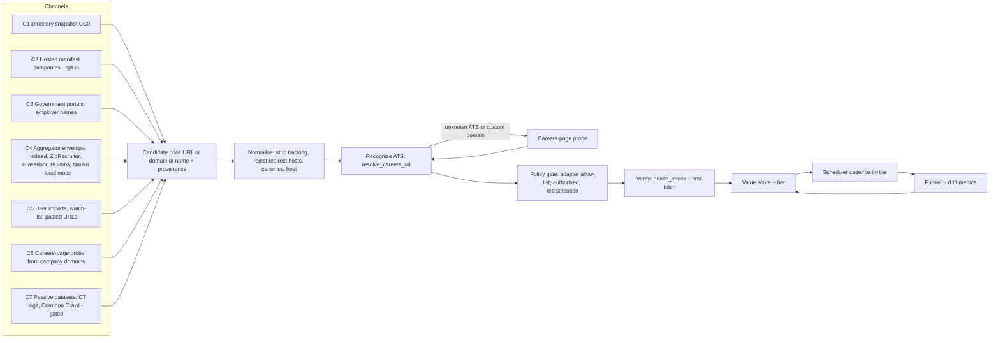

# 09 — Adversarial Review of the Plan and Methodology Specification

Date: 2026-11-02 (feasibility-reviewed in [10](10_METHODOLOGY_FEASIBILITY_REVIEW.md); where doc 10 differs, doc 10 wins and the text below has been patched) · Amends [FINAL_SYSTEM_STRATEGY_AND_DESIGN.md](FINAL_SYSTEM_STRATEGY_AND_DESIGN.md), [03](03_TARGET_ARCHITECTURE.md), [04](04_DATA_AND_INTEGRATION_DESIGN.md), [07](07_IMPLEMENTATION_ROADMAP.md), [08](08_REVISION_1_PLATFORM_SCOPE_AND_REVIEW_RESPONSE.md). Where this document and an older one disagree, **this document wins** and the older text has been patched (§C).
Design and documentation only. Evidence labels: **[verified]** = I inspected the package/code in this session; **[arithmetic]** = computed from stated inputs, not measured; **[unverified]** = could not be checked from my sandbox (no route to those hosts) or taken from the pasted comparison/research; **[target]** = a number to be set after a first measured baseline.

# Part A — Adversarial review of the plan

I tried to break the plan as it stood after Revision 1. Ratings: **Critical** (the plan fails its goal), **High**, **Medium**, **Low**.

| ID | Finding | Evidence | Sev. | Core fix | Where fixed |
|---|---|---|---|---|---|
| A1 | **The "harvest employer links from JobSpy and LinkedIn" mechanism does not work for LinkedIn.** The LinkedIn scraper in `python-jobspy` 1.4.1 sets only `job_url` and `company_url` (a LinkedIn company page); it sets no apply URL and no employer website. Getting one would need an extra request per job — more scraping of the most restrictive board. | **[verified]** `jobspy/linkedin/__init__.py` (only `company_url`, the LinkedIn page); no `job_url_direct`/`company_url_direct` anywhere in that module | **Critical** | Treat LinkedIn as a *job* source only. Harvest from the boards that actually expose employer fields (Indeed, ZipRecruiter, Glassdoor, BDJobs, Naukri) and from other channels (§B1). | B1, B2 |
| A2 | **The current scanner throws away the fields that would feed discovery.** `scanners/jobspy_scanner.py` reads title, URL, company, location, description, date, salary, site — never `job_url_direct`, `company_url`, `company_url_direct`. The "provider envelope" the comparison calls for does not exist. | **[verified]** grep of the scanner; JobSpy sets `job_url_direct` (Indeed, ZipRecruiter, BDJobs, Naukri) and `company_url_direct` (Indeed, Glassdoor, ZipRecruiter, BDJobs) | High | `ProviderEnvelope` that keeps URL fields per row, **not** `emails` (third-party personal data; recruiter outreach is a non-goal). New defect DEF-15. | B1 (C4), P5a |
| A3 | **The plan's main scale mechanism vanishes on the platform.** Consumer boards are local-mode only in hosted mode (OT-12), so a platform relying on JobSpy harvesting would have *no* discovery at scale. | doc 08 §4.1/§6; OT-12 | **Critical** | Discovery must be a **multi-channel funnel in which every channel works without JobSpy**; JobSpy is one optional, local-mode channel. | B1 |
| A4 | **I planned to build a recognizer that already exists.** `ats_scrapers.resolve.resolve_careers_url()` is a deterministic, offline URL → (ATS, slug) function covering 20+ ATS families (path, subdomain and full-URL tenants), and says custom-domain career sites cannot be recognized from the URL alone. My "table-driven recognizer from prior knowledge" duplicates it and would be less tested. | **[verified]** `resolve.py` (406 lines), `get_scraper_for_url` | High | Reuse it as the recognition core; own only the **policy gate, normalisation (tracking/redirect rejection), tests and a unit-of-work wrapper**. | B2 |
| A5 | **Recognition is not permission, and not value.** A recognized ATS may have a blocked scraper (`darwinbox`, `uber` use a TLS-impersonation engine; `avature`, `meta`, `tesla` a stealth browser), may be unauthorised (SmartRecruiters), may have 0 jobs or only non-EN/DE jobs. Thousands of such boards would burn the request budget and flood the corpus. | **[verified]** adapter engines (doc 01 §4.3); plan had no policy step after recognition and no value model | High | Funnel stages with a **policy gate after recognition**, a **verification probe**, a **value score** and **tiers** with budgets (B2–B5). | B2–B5 |
| A6 | **Expected recognition yield is unknown and probably low for aggregator links.** `job_url_direct` from a board may be a board redirect, not an employer ATS URL; the plan forbids following tracking redirects (correctly), so many harvested links will be unrecognizable. The comparison's "thousands of companies without hand-seeding" is unproven. | **[unverified]** link shapes per provider; no run yet | High | Measure the funnel (B13); decide which channels survive by their yield and cost; never claim a number before the baseline. | B13 |
| A7 | **Government portals are job sources, not discovery channels.** Bundesagentur and EURES rows carry the employer *name* only (EURES often a placeholder); neither adapter surfaces an employer website or an ATS link. I had listed them as help for finding employers. | **[verified]** `bundesagentur.py`, `eures.py` docstrings (employer name in `company`; placeholder employers in EURES) | Medium | Use them as sources (P11); for discovery use them only to enrich the *company catalog with names*; resolving a name to a domain is a separate, unproven step (B4). | B1 |
| A8 | **No company entity resolution.** `company` is unique on (provider, identifier) only. The same employer under several boards/domains/names is several rows; **staffing/recruiting agencies** (large in the German market) post for undisclosed clients and would pollute duplicates, eligibility and "company" feedback. | doc 04 §10 `company`; no agency concept | High | Domain-first merge, alias table, `company_type` (employer / agency / aggregator) with heuristics (B4). | B4 |
| A9 | **No capacity model.** Nothing says how many boards the scheduler can afford, how requests are allocated, or what happens at cold start when no user has defined a scope. | doc 08 §4.1 "demand-driven scopes" without numbers | High | Value tiers + global and per-host request budgets + explicit cold-start rule, with the arithmetic shown (B5). | B5 |
| A10 | **"Complete snapshot" is asserted, not validated.** Some endpoints cap silently (Bundesagentur 10,000 per query, EURES page ≤ 200, Workday 2,000). A capped list that looks complete would let two "consecutive complete misses" close live jobs. | **[verified]** adapter caps; plan's `coverage` declared by the adapter | High | **Cap detection** and provider-total cross-check before `coverage=complete` (B6). | B6 |
| A11 | **Volume guard has blind spots.** Medians under 4 are unprotected; and a failure on **our** side (network outage, DNS) hits many sources at once but each looks like a small drop. | doc 08 §4.9 | Medium | Add a **global cycle breaker** (if > 50 % of sources in a cycle fail or return zero, abort the cycle's lifecycle changes) and a two-run confirmation for small sources (B6). | B6 |
| A12 | **Conditional requests may save nothing.** Many ATS JSON endpoints send no `ETag`/`Last-Modified`. The plan assumed savings. | **[unverified]** per provider | Low | ETag when offered, else a **payload hash**; savings are measured per source, never assumed (B7). | B7 |
| A13 | **The generic JSON-LD recipe (R12) had no methodology**, only a deferred line. It touches arbitrary third-party sites, so robots.txt, rate and legal handling must be specified before any code. | doc 07 P11 one-liner | High | Full careers-page probe + JSON-LD method with budgets and closure rules (B8, B9). | B8, B9 |
| A14 | **Seniority and skill extraction had goals but no algorithm.** "Rules first, LLM fills gaps" does not say how the Ericsson-style error (title says mid-level, text says 10+ years) is prevented, how German compounds are handled, or how quality is measured. | doc 08 §4.2 | High | Explicit evidence-weighting function, ESCO matching ladder, open-vocabulary retention, labelled evaluation protocol (B10). | B10 |
| A15 | **Adaptive schedules and drift monitoring were one-liners** ("later optimisation", "anomaly detection"). | doc 07 P11/P12 | Medium | Formulae, baselines and alert actions (B11, B12). | B11, B12 |
| A16 | **Harvested company facts from consumer boards have an unclear status in hosted mode.** "Company X uses ATS Y" is a derived fact, but obtaining it required scraping a restricted tier. | doc 08 C-5 | Medium | Tag `discovered_via=harvest:<provider>`; such entries stay **private to the local-mode instance** and are excluded from any shared catalog until OT-14/OT-17 clears them. | B1, B14 |
| A17 | **Connector breadth lacked per-connector methodology** (how each is paged, detailed, validated, capped). | doc 07 P11 ordered list | Medium | Connector specification table + registry-first rule (B8). | B8 |
| A18 | **Passive public datasets (Certificate Transparency, Common Crawl, open company registries) were never considered**, although they are the only compliant way to reach thousands of tenants without hand-seeding or scraping boards. Their feasibility and terms are **not** verified. | **[unverified]** | Medium | Certificate Transparency is likely **infeasible** for wildcard-certificate providers (doc 10 F7); Common Crawl is a candidate behind a measured proof-of-concept (OT-17); never brute-force guessed names. | B1 |

**Self-corrections made in this revision:** doc 08 §4.8 said "build a recognizer" (A4) and implied LinkedIn results carry employer links (A1); both are corrected below. The recognizer URL patterns listed there were from prior knowledge; the verified source is `resolve.py`.

# Part B — Methodology specification

## B1. Discovery funnel (how the catalog reaches thousands of companies without hand-seeding)

| Channel | Yields | Mode | Basis / compliance | Evidence | Notes |
|---|---|---|---|---|---|
| **C1** `ats-directory` snapshot | board slugs for Ashby, Greenhouse, Lever, Recruitee, Rippling (1,804 rows) | local + hosted | CC0 data | **[verified]** rows/providers/licence | startup-heavy; no Workday/Personio/Workable/SmartRecruiters |
| **C2** hosted dataset manifest (`ats_scrapers.manifest`: snapshot, per-ATS slices, deltas, `companies`) | company list for cold start | opt-in only (OT-7) | third-party hosted data; terms unverified | **[verified]** module exists; content/terms **[unverified]** | never default |
| **C3** Bundesagentur, EURES | employer **names** for German/EU employers | local + hosted if terms allow (OT-14) | public portals | **[verified]** name only, no link; EURES placeholders | name → domain resolution is unsolved (see B4) |
| **C4** aggregator envelope | `job_url_direct`, `company_url_direct`, `company_url` already returned by scans | **local only** | data already fetched by an enabled, owner-acknowledged tier; **no extra requests** | **[verified]** fields per provider: Indeed (direct + company website), ZipRecruiter (direct + website), Glassdoor (website), BDJobs (direct + website), Naukri (direct); **LinkedIn: none**; Bayt/HelloWork: board company page only | `emails` never stored; redirect/tracking URLs never followed |
| **C5** user-supplied | URLs/domains from imports, watch-list, forwarded emails | local + hosted (private) | user's own data | design | highest precision, lowest volume |
| **C6** careers-page probe | ATS embeds or JSON-LD found on an employer's own site | local + hosted | public pages, robots.txt honoured, ≤ 5 requests/domain/30 days | design (B8) | input = domains from C4/C5/open datasets |
| **C7** passive datasets | URLs of path-based and subdomain ATS hosts from the **Common Crawl URL index** (CT logs demoted: wildcard certificates hide tenants, doc 10 F7) | batch, gated | public dataset; **terms/feasibility unverified** | **[unverified]** (OT-17) | validate **recall and precision against the 1,804-row directory** before trusting; enumerate from existing data only; **never** dictionary-guess names |
| rejected | search-engine scraping (`site:` queries), brute-force slug guessing, scraping competitors' company lists, scraping LinkedIn company pages | — | ToS / policy | — | consistent with "never guess endpoints" |

Provenance is stored on every candidate (`discovered_via`, channel, first seen). Harvested entries from C4 carry `discovered_via=harvest:<provider>` and are **not** shared outside the local instance until OT-14/OT-17 allow it (A16).

## B2. Recognition (URL → ATS)

1. **Normalise:** lower-case host; strip `utm_*`, `gh_jid`, tracking params and fragments; drop empty paths. **Reject without fetching** board/redirect/tracker hosts (job boards, `lnkd.in`, click-tracking and email-redirect domains). A rejected link is counted, never followed.
2. **Recognize:** call `resolve_careers_url(url)` **[verified to exist]**; result `(ats_type, slug_or_tenant, confidence, via)`. It is offline and deterministic; custom-domain career sites return `None`.
3. **Escalate unknowns** to the careers-page probe (B8) **only** if the URL is an employer domain (e.g. `company_url_direct`), at most once per domain per 30 days.
4. **Classify** the outcome: `recognized_supported` → continue; `recognized_blocked_by_policy` (adapter on the block-list or unauthorised) → store, do not poll; `recognized_unsupported` (ATS known to the resolver but no adapter) → store and **count per ATS** — this count is the data-driven priority list for the next connector (B8); `unrecognized` → TTL 90 days.
5. **Fixtures:** one table-driven test per ATS family with real-shaped URLs and junk URLs; no endpoint is ever constructed except from a recognized `(ats, slug)`.

## B3. Verification and activation
For each `recognized_supported` candidate: (1) `health_check` — one lightweight request; board exists; (2) first fetch through the adapter with a hard item cap (100) and a response-size cap; (3) classify: `dormant` (0 jobs; re-probe in 30 days), `low_language_value` (< 10 % of sampled jobs `en`/`de`; poll rarely), `ok`. A source row is created in `validating`; it becomes `active` when the adapter fixtures are green and the canary passes (the owner-simplified rule). Failures are recorded with the HTTP status class; a 401/403/429 opens the circuit breaker for that host and the candidate returns to `candidate` with a cool-down.

## B4. Company entity resolution and typing
- **Key order:** registrable domain (public-suffix aware) → ATS identity → `name_norm` (case-folded, legal suffixes `GmbH, AG, SE, Inc, Ltd, LLC, …` removed, whitespace collapsed). Two candidates merge when they share a domain, or an ATS identity, or `name_norm` **and** country. Requires a public-suffix list: `tldextract` in **offline mode** (bundled snapshot, no runtime fetch; BSD-3, maintained — OT-18).
- **Aliases:** every seen name/domain is kept in `aliases_json`; merges are logged and undoable (consistent with defaults-first review).
- **`company_type`:** `employer | agency | aggregator | unknown`. Agency heuristics (any two): name tokens (`Personal`, `Zeitarbeit`, `Personaldienst`, `Recruiting`, `Staffing`, `Talent`, `Search`, `Interim`), postings that omit the employer ("our client"/"unser Kunde"), unusually broad multi-industry job mix, many postings with identical templates. Agency jobs are kept but flagged; they are never merged across clients and are down-weighted in duplicate grouping. **Advisory only** (never an exclusion) until precision is measured on ≥ 100 labelled German company names; tokens like `Talent` or `Search` also occur in ordinary employer names (doc 10 F9).
- **Name-only candidates** (C3) cannot be polled; they are kept for display and for later domain resolution. No guessing of domains from names.

## B5. Value model, tiers and capacity
- **Value score** per board: `V = 0.40·S + 0.25·F + 0.20·L + 0.15·Z − 0.30·E`, each term in [0,1]: `S` share of the board's jobs inside currently demanded scopes (country × occupation family × language), `F` freshness (postings in last 30 days / active jobs, capped), `L` language fit (`en`+`de` share), `Z` size (`log(1+active_jobs)/log(1+1000)`), `E` recent error rate. Weights are initial values to be tuned **[target]**.
- **Tiers:** A (`V ≥ 0.6`) base interval 3 h; B (`0.3 ≤ V < 0.6`) 12 h; C (`V < 0.3`) 48 h; `dormant` re-probe 30 days. Interval then adapts by B11 within provider minimums.
- **Cold start (no demanded scopes):** poll the user watch-list plus the directory boards ranked by size, up to the budget; once any profile exists its scopes take over.
- **Budgets:** global requests/day cap and per-host token buckets (Greenhouse, Lever, Ashby: documented/observed limits recorded in the registry; Workable < 8 req / 40 s per tenant; Workday ≈ 90 req/min global **(from the Decision Log, unverified)**); detail fan-out (Workday, Personio, Workable, Greenhouse pay) is **incremental** via `source_item_state`, so cost scales with *new/changed* jobs, not board size.
- **Capacity arithmetic [arithmetic]:** 1,804 directory boards at 3 h = 8 polls/day → 14,432 list requests/day (≈ 0.17 req/s). A 10,000-board catalogue with 10 % tier A (1,000 × 8), 30 % tier B (3,000 × 2) and 60 % tier C (6,000 × 0.5) = 8,000 + 6,000 + 3,000 = **17,000 list requests/day** (≈ 0.2 req/s), plus incremental detail calls. Per-host buckets, not the global rate, are the binding constraint.  **Onboarding throttle [arithmetic]:** first sync of a detail-heavy board is costly (a 2,000-job Workday tenant at 1.5 req/s ≈ 22 minutes; 100 such tenants ≈ 37 hours), so new boards are admitted at ≤ 20 per day by default, each with a first-sync budget; later syncs are incremental (doc 10 F11).

## B6. Lifecycle, closure and guards (single consolidated rule set)
1. **Identity:** ATS id (`global_id = ats_type:ats_id`); a URL change never makes a new job.
2. **Coverage must be earned.** An adapter may report `complete` only if all hold: pagination ended by a provider signal (no next page / total reached); the item count is **not** equal to a known cap (10, 20, 25, 50, 100, 200, 250, 500, 1000, 2000, 10000) unless the provider's reported total confirms it; for capped APIs (Workday 2,000, Bundesagentur 10,000, EURES page 200) the partition covered every leaf without hitting the cap. Otherwise `partial`.
3. **Closing:** a job is closed after **two consecutive** runs with `coverage=complete`, `status=ok`, non-empty, in which it is absent. Reappearance reopens it.
4. **Volume guard with re-baselining (v2, doc 10 F1).** Scope with ≥ 5 prior complete runs: `count < 0.5 × median(last 7 complete runs)` (median ≥ 4), or 0 when the median > 0 → run `partial`, no lifecycle change, not part of the baseline. **Without a recovery rule this locks a source forever after a real drop** (simulated: a 200-job board stayed flagged for 214 of 240 runs and kept 155 closed jobs open). **Recovery:** after `k = 3` consecutive flagged runs whose counts are stable (`max/min ≤ 1.15`) the new level is accepted as the baseline and normal closing resumes. **Safety clause:** a drop of more than 80 % (including zero) requires `k = 8` runs spanning ≥ 24 h, a passing `health_check`, and no simultaneous global-breaker trip, so a stable *outage* is never re-baselined to zero. **Small sources (median < 4):** a drop to 0 is applied only after a second confirming run. Mandatory fixtures: real 60 % drop; stable zero outage; transient dip.
5. **Global cycle breaker:** if more than 50 % of sources scheduled in a cycle fail or return zero, **no** lifecycle change is applied for that cycle and a health alert is raised (guards against our own network/DNS failure).
6. **304 / unchanged payload:** `not_modified` counts all known ids as seen. If the endpoint sends no validators, compute a payload hash; an identical hash short-circuits parsing and counts as seen.
7. **Explicit expiry signals** override absence logic: `validThrough` in the past, provider status `closed`, 404/410 on a direct re-check (bounded, ≤ 1 re-check per job per run).
8. **Tests:** disappear→reappear fixture; capped-list fixture (count = cap, no total) stays `partial`; zero-result outage fixture; global breaker fixture; URL-change fixture.

## B7. Change detection and conditional requests
`content_hash = sha256(normalised title ‖ description ‖ location ‖ salary_text ‖ status)`. A new `job_version` row is written only when the hash changes; `updated` is derived from it. Requests use `If-None-Match`/`If-Modified-Since` where the provider returned validators earlier (`source_http_cache`); otherwise the **whole-payload hash** applies. Savings are **measured per source** (requests avoided, bytes avoided) and shown in Diagnostics; none are assumed.

## B8. Connectors and the careers-page probe

**Registry-first rule (before adding any connector, P4):** one class per provider registered in a table with capability flags — `list_complete`, `needs_detail`, `detail_incremental`, `supports_conditional`, `known_cap`, `requires_authorisation`, `policy_blocked`. Shared ingestion code contains **no provider-name branching** (lint test). This replaces the `if/elif` monolith pattern.

**Library-risk rule (doc 10 F5, F6, OT-19).** `ats-scrapers` is ~14 weeks old with 3 releases and a single author, and `python-jobspy` shipped four minor versions in 21 days. Therefore: adopt the **resolver** now (pure function, tested); keep `scanners/ats.py` (Greenhouse/Lever/Ashby parsers) as the tested fallback until the library adapters have passed live verification and run clean for ≥ 4 weeks; pin exact versions with hashes; copy the used modules into `third_party/` (MIT) if upstream goes quiet; run adapter contract tests against recorded fixtures on every upgrade; review upgrades monthly, never automatically.

| Connector | Method (from adapter inspection / Decision Log) | Coverage declaration | Methodology notes | Acceptance |
|---|---|---|---|---|
| Greenhouse | board list with content; pay-transparency enrichment is **missing** **[verified]** | complete | bounded per-job pay call only for jobs missing pay and passing scope; patch module | fixture with/without pay |
| Lever, Ashby | single JSON payload | complete | Ashby: listed-only; compensation flag | fixtures |
| Workable | widget JSON list + per-job `.md` detail **[verified]**; concurrency 4, retries | complete if list not capped | shortcode grouping, rate cap, `v3` fallback **not seen — verify, then patch (D5)** | fixtures + 429 behaviour test |
| Recruitee | `GET {slug}.recruitee.com/api/offers`, single payload, custom domains via full URL **[verified]** | complete | **fallback ladder missing** (JSON → XML → `data-props`) — build before **2027-02-10** (D5) | ladder fixtures |
| Personio | list endpoints; **description empty in list**, per-job HTML fan-out **[verified]** | complete | incremental detail via `source_item_state`; `.de/.com` fallback | fixtures, detail-skip test |
| Teamtailor | RSS `/jobs.rss`, single request **[verified]** | complete | XML via `pydantic-xml`; DTD rejected | fixtures |
| Workday | 20/page list, 2,000 cap → facet subdivision (exists in library) **[verified]**; detail by `externalPath` | complete only if no leaf hits the cap | **add** persisted `source_item_state`, global limiter, tenant/locale validation (D3, OT-2) | live >2,000-board test on owner's machine |
| Bundesagentur | `size=100 × page ≤ 100` = 10,000 cap per query; partition by facets; cover capped at 25,000 **[verified]** | complete only after verified cover | employer name only; polite concurrency 2; demand-driven by region/occupation/date | partition fixture; count cross-check |
| EURES | page ≤ 200; placeholder employers common **[verified]** | partial unless partition exhausts | hide placeholder employers from company catalog | fixture |
| JSON-LD (generic) | B9 | partial | per-domain budgets | B9 tests |

**Demand-driven connector order:** the per-ATS `recognized_unsupported` counts from B2 reorder the P11 list after the first measured baseline; the default order (Recruitee, Bundesagentur/EURES, Workable, Personio/Teamtailor, Workday, Greenhouse pay) stands until then.

**Careers-page probe (C6), for custom-domain employers:** (1) fetch `robots.txt`; stop if the path is disallowed for our user agent; honour `Crawl-delay`. (2) Fetch the domain's careers entry points in order — links found on the homepage whose path or anchor text matches career terms (`careers, jobs, karriere, stellenangebote, join us, offene stellen`), then `/careers`, `/jobs`, `/karriere` — **max 5 requests per domain per 30 days**. (3) In the static HTML only (no JavaScript execution, no forms, no login) look for: embedded ATS hosts in `src`/`href`/`action` attributes → `resolve_careers_url`; JSON-LD `JobPosting`; sitemap entries declared in `robots.txt`. (4) Record the outcome with a TTL (hit: re-verify yearly; miss: 90 days). Identify the crawler honestly in the user agent.

## B9. Generic JSON-LD recipe (R12)
- **Eligibility:** only for domains whose `robots.txt` allows it and that are verified employers (C4/C5); never for job boards.
- **Discovery:** sitemap(s) declared in `robots.txt` → URLs matching job patterns; fall back to links from the careers page. Respect `lastmod` for incremental fetches; ≤ 1 request/s; per-domain daily cap.
- **Extraction:** parse `application/ld+json` for `@type: JobPosting` (via `extruct`, added only when this recipe ships); require `title`, `description`, `datePosted`, `hiringOrganization`, and `jobLocation` or remote requirement (the required set must be re-checked against the current schema.org/search-engine guidance before coding **[unverified detail]**); strip HTML to text; map to canonical `Job`; keep `validThrough`, `employmentType`, `baseSalary` where present.
- **Coverage:** `partial` unless the sitemap is declared complete by `lastmod` consistency checks (rare). **Closure only by explicit signals** (B6.7): `validThrough` passed, 404/410 on a bounded re-check, or removal from two consecutive sitemap snapshots of a domain whose sitemap has been stable.
- **Failure handling:** pages that parse but fail validation are quarantined with a sample for fixtures; a drop in valid-JSON-LD rate trips drift monitoring (B12).

## B10. Enrichment: language, taxonomy, seniority, skills, salary
1. **Language detection (stdlib).** Tokenise; `score_L = (tokens in top-100 stop-words of L) / tokens`, for `L ∈ {en, de}`, plus a German character hint (`ä ö ü ß`). Initial rules **[target — tune on labelled data]**: both scores < 0.08 → `unknown` (short text) or `other` (≥ 200 tokens); `|score_en − score_de| < 0.03` → `bilingual` flag with the higher score as `language`; else the higher score. A library is added only if the labelled set (≥ 200 EN/DE/other postings) misses its target. **Policy for `unknown` (doc 10 F4):** `unknown` with ≥ 40 tokens → hidden as `other`; under 40 tokens → provider `language` field or source country; otherwise visible with `language_unknown`. The labelled set includes Dutch, Danish, Swedish, Polish and Italian as the nearest confusions; the `bilingual` flag is advisory because both `en` and `de` are kept.
2. **Sectioning.** Split descriptions on headings and cue lines into *role*, *requirements*, *nice-to-have*, *benefits*, *company*; extraction runs on requirement sections first so benefits ("30 days holiday") are never read as requirements. German cues: `Ihr Profil, Anforderungen, Wir erwarten, Das bringen Sie mit, Wünschenswert, von Vorteil, Wir bieten`; English: `Requirements, You bring, What you'll need, Nice to have, Preferred, We offer`.
3. **Skills — matching ladder against ESCO (EN/DE labels):** exact label → alternative label → normalised exact (case, hyphens, `&`/`and`/`und`) → multi-word fuzzy (RapidFuzz token-set ≥ 90) → **unmatched phrase kept** as `skill_unmapped` with its evidence sentence (open vocabulary; the failure of a closed list is the lesson from the comparison). No German compound splitting in v1; compounds match only through ESCO labels or remain unmapped. ESCO is a data file whose terms must be checked (OT-14). **Measure before relying on it:** report the *mapped share* on the labelled set; skill-coverage scoring compares normalised strings plus ESCO synonyms, so an unmapped skill still counts (doc 10 F10).
4. **Seniority — evidence-weighted vote.** Each piece of evidence votes for a level with a weight:

| Evidence | Votes | Weight |
|---|---|---|
| `years_required` (minimum of a range; age statements ignored) | ≥ 5 → `senior`; 3–4 → `mid`; 1–2 → `entry`; 0 or "no experience" → `entry` (**years alone never give `lead_exec`**) | 0.50 |
| scope/management cues (`lead a team`, `manage`, `budget responsibility`, `Führungsverantwortung`, `Budgetverantwortung`, `Teamleitung`) | `senior`; with ≥ 8 years or an executive title → `lead_exec` | 0.30 |
| entry cues (`graduate`, `Berufseinsteiger`, `Werkstudent`, `Praktikum`, `Trainee`, `Ausbildung`) | `student`/`entry` | 0.60 |
| title keywords (`Senior/Sr./Lead/Principal/Head/Director/Leiter`; `Junior/Jr.`) | matching level | **0.15 (weak prior)** |
| degree level | weak support | 0.10 |

   Level = argmax of summed weights; `confidence` = margin ÷ total. **`lead_exec` requires an executive title (`Director, Head of, VP, Chief, Geschäftsführer, Bereichs-/Abteilungsleiter`) or a scope cue together with ≥ 8 years.** Total weight < 0.30 → if only a title keyword exists, emit `seniority_hint` with `evidence=title_only` and low confidence (used with reduced weight, never to hide a job); otherwise `unknown`. **Override rule:** when `years_required ≥ 8`, no title can lower the level below `senior`. **Regression fixtures (prototype-verified):** mid-level title + "10+ years" + "3+ years as architect" → `senior` (not `mid`, not `lead_exec`); "Senior Backend Engineer (m/w/d)" alone → `senior` with `title_only`; "at least 18 years old" → no years.
5. **Years extraction regexes** (EN/DE): `(\d+)\s*\+?\s*(years?|yrs)`, ranges `(\d+)\s*[–-]\s*(\d+)\s*years?`, `mind(?:estens)?\.?\s*(\d+)\s*Jahre`, `(\d+)\s*[–-]\s*(\d+)\s*Jahre\s+Berufserfahrung`, `langjährige Erfahrung` → treated as `≥ 5` with low confidence. Also handled in the prototype: spelled-out numbers (`three`, `drei`), ranges, `über`, `mind.`/`mindestens`, `mehrjährig`/`langjährig` (≥ 5, low confidence); company-history sentences (`we/our/wir/unser` without a candidate cue) are skipped; sectioning quality is unmeasured.
6. **Role family:** title + requirement phrases → ESCO occupation → ISCO-08 major group via lexical match; unknown allowed.
7. **Salary:** structured fields first; else parse text with EN/DE number formats; evaluate reuse of `ats_scrapers.enrichment.parse_salary_range` **[verified to exist; DE formats unverified]**; stored as stated, never scored (doc 08 §4.4).
8. **Evaluation protocol:** a labelled set of ≥ 50 postings per language and ≥ 10 occupation families (not only IT): measure required-skill recall/precision, seniority macro-F1 with confusion matrix, language accuracy, eligibility-cue recall; track per release; error analysis list reviewed before any prompt or rule change. Pass thresholds are **[target]** until the first baseline.

## B11. Adaptive per-source schedules
`r_i` = EWMA (α = 0.3) of `(new + updated + closed) / max(1, active_jobs)` over complete runs. `interval_i = clamp(base_i · r_ref / max(r_i, r_min), min_i, max_i)` with `r_ref = 0.05`, `r_min = 0.005` **[target]**, `base_i` from the tier (B5), `min_i/max_i` from provider rules (never below a provider's documented minimum or its cool-down; ×2 after an error; × 4 while `degraded`). Example: tier-A board, base 3 h, observed change 1 % → `3 h · 0.05/0.01 = 15 h`; a board with 10 % change → `3 h · 0.05/0.10 = 1.5 h`, raised to its `min_i` (e.g. 3 h). Jitter ±10 %. Ships after fixed intervals (P2) and the first baseline.

## B12. Yield, quality and drift monitoring
**Per source and run:** jobs fetched; new/updated/closed ratios; request count and HTTP status mix; parse-failure rate; null-rate of `description`, `location`, `posted_at`; language mix; duplicate ratio; median job age; time per run.
**Detector:** for each metric keep the last 14 runs (needs ≥ 7); robust z-score `z = 0.6745 · (x − median) / max(MAD, 0.05·median, 1)` — **without the floor, small stable boards raise false alarms on 16.9 % of days (simulated)**. `|z| > 3.5` → *warn*; `|z| > 5`, schema-failure rate > 5 %, or the B6 guards → *critical*: source `degraded`, lifecycle frozen for that source, quarantined batch kept for fixtures. **Per-board detection runs only when the board's median ≥ 20 jobs** (simulated power for a 50 % drop within 5 days: ~20 jobs 80 %, ~55 jobs 97 %, ~200 jobs 100 %; ~6 jobs 7 %). **Smaller boards are covered by the volume guard and by a cohort detector** on summed counts per ATS provider and tier (catches adapter/schema breakage; power untested — doc 10 F2). Any rule that fires is shown with the numbers compared.
**Discovery quality (B13)** is monitored on the same page.

## B13. Evaluating discovery itself
Funnel metrics per channel and week: `harvested_unique` → `normalised` → `recognized_supported` → `verified` → `active_with_in_scope_jobs`. Ratios: recognition rate, verification rate, activation rate; **cost** = requests per activated company; **value** = in-scope jobs per activated company; duplicate share of new jobs; time from harvest to first in-scope job. Rules: a channel whose activation rate or value-per-request stays in the bottom quartile for 4 weeks is paused (kill switch). All targets are **[target]** and set after the P0 live probe and the first local-mode runs; no yield figure is claimed in this plan. **Ground-truth check (doc 10 F7):** the CC0 directory (1,804 known boards) is used as a known-answer set — any new channel is scored on *recall* (share of directory slugs it finds) and *precision* (share of its recognised hits that verify) before it is trusted.

## B14. Governance and safety constraints (apply to every method above)
No CAPTCHA/login/paywall handling; no proxy rotation; no stealth or TLS-impersonation adapters (block-list test, doc 06 G3); a 401/403/429 opens the host circuit breaker and is never retried through another route; robots.txt honoured for all non-API pages; tracking and redirect links never followed; recruiter e-mails never stored; `redistribution` per source enforced in hosted mode; harvested data from consumer boards stays local; provider terms reviewed before a source is enabled for others (OT-14, OT-17).

## B15. Test inventory for this document
Recognition fixtures (supported / blocked-by-policy / unsupported / unknown / tracking host); envelope retention (fields kept, `emails` dropped); careers-probe budget and robots tests (disallowed path, crawl-delay, 5-request cap); entity-merge and agency-flag fixtures; value-score and tier boundary tests; capacity-budget enforcement test; cap-detection, cycle-breaker and small-source confirmation fixtures; payload-hash short-circuit; connector registry lint; JSON-LD validation/quarantine; seniority regression set and years regex table (EN/DE); language-detector labelled set; schedule-formula table test; drift detector on synthetic series with injected drops; funnel metric computation test.

# Part C — Roadmap mapping and patches

| Methodology | Phase | Acceptance added (measurable) |
|---|---|---|
| B1 channels C1, C5; envelope (C4) | P5a/P5c | envelope keeps link fields and drops `emails` (test); LinkedIn rows yield no harvest links (documented test) |
| B2 recognition (reuse `resolve`) | P5c | fixture table passes; blocked/unsupported classes populated; no network in tests |
| B3 verification | P5c | candidate → `validating` → `active` or `dormant` with reason |
| B4 entity resolution, agencies | P5c | merge/undo fixtures; agency flag on a labelled set |
| B5 value, tiers, budgets | P4 (budgets), P5c (tiers) | request counter never exceeds configured budget in a 24 h simulation |
| B6 guards | P4/P6 | fixtures listed in B6.8 |
| B7 hashes, conditional | P4/P6 | savings reported per source |
| B8 registry + connectors | P4 (registry), P11 (connectors) | lint + per-connector acceptance table |
| B8 careers probe, B9 JSON-LD | P11 (after baseline) | robots/budget tests; validation/quarantine tests |
| B10 enrichment | P8 | labelled-set report, regression fixtures |
| B11 adaptive cadence | P12 | formula table test; no interval below provider minimum |
| B12 drift monitoring | P4 (metrics collection), P12 (detector) | injected-drop test raises `degraded` |
| B13 funnel evaluation | P5c onward | weekly funnel table produced; kill switch tested |
| C7 passive datasets | after OT-17 | not scheduled until verified |

**Patched in older documents:** doc 08 §4.8 (recognizer reuse, LinkedIn correction), doc 01 (DEF-15), doc 03/04 recognizer references, doc 07 (deltas §6), primary document (links, AD-20, OT-17, audit row). New open decision **OT-17** (passive datasets: Certificate Transparency, Common Crawl, open company registries — feasibility and terms; default: not enabled) and DEF-15 (envelope fields dropped).
