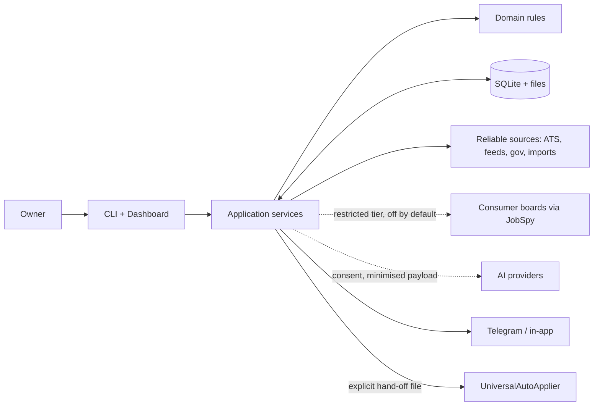

# JobHunter — Final System Strategy, Architecture and Technical Design

Date: 2026-11-01 (Revision 1: 2026-11-02, see [08](08_REVISION_1_PLATFORM_SCOPE_AND_REVIEW_RESPONSE.md); Revision 2: 2026-11-02, see [09](09_REVIEW_AND_METHODOLOGY_SPECIFICATION.md); where docs 08/09 and older text differ, the newer document wins and the text below has been patched) · Type: design and documentation only (no production code, schema or config was changed) · Branch: `docs/final-design` (from `feature/extra-sources` @ `3177234`)

| Document | Content |
|---|---|
| **this file** | consolidated strategy, architecture summary, decisions, open decisions, validation audit, executive report |
| [01 Existing system assessment](01_EXISTING_SYSTEM_ASSESSMENT.md) | evidence, maturity matrix, defects, dispositions |
| [02 Decision traceability](02_DECISION_TO_ARCHITECTURE_TRACEABILITY.md) | D1–D10 → architecture, conflicts and their resolution |
| [03 Target architecture](03_TARGET_ARCHITECTURE.md) | diagrams, components, layering, CLI/UI parity, AI, matching |
| [04 Data and integration design](04_DATA_AND_INTEGRATION_DESIGN.md) | schema, profile model, adapter contract, dedup/lifecycle, migration |
| [05 UX and workflows](05_USER_EXPERIENCE_AND_WORKFLOWS.md) | IA, onboarding, screens, journeys, document workflow |
| [06 Quality, security, operations](06_QUALITY_SECURITY_AND_OPERATIONS.md) | tests, gates, security/privacy, dependencies, cost, Windows |
| [07 Implementation roadmap](07_IMPLEMENTATION_ROADMAP.md) | phases P0–P12 with acceptance criteria |
| [08 Revision 1](08_REVISION_1_PLATFORM_SCOPE_AND_REVIEW_RESPONSE.md) | platform scope (any user, any country, EN/DE), red-team response, comparison findings, new designs, instruction ledger with conflicts |
| [09 Review and methodology specification](09_REVIEW_AND_METHODOLOGY_SPECIFICATION.md) | adversarial review of the plan (18 findings with severity and fix); methodology for discovery at scale and every other comparison point; roadmap mapping |
| [10 Methodology feasibility review](10_METHODOLOGY_FEASIBILITY_REVIEW.md) | experiments and simulations run against the methodology; 15 findings; feasibility verdict per method; Minimum Viable Methodology (release R1) with kill criteria |
| [docs index](README.md) | reading order, authority rule, revision history, supersession table |

## 1. What JobHunter becomes

A **job-search platform for any user in any country**, collecting English and German postings across all professions. One codebase runs either as a **local single-user app** (Windows-first; SQLite; dashboard on `127.0.0.1`; CLI) or, from phase P13, as a **hosted multi-user service** with a shared ingestion plane and per-user matching (doc 08 §4.1). It:

1. **Discovers** jobs broadly and honestly: employer ATS boards, government portals, public remote feeds and user imports as the reliable base; consumer boards (via `python-jobspy`) as an optional, policy-gated, default-off tier.
2. **Normalises and deduplicates** everything into one canonical `Job` model (the 30-field `ats-scrapers` schema), links the same posting across sources, and tracks `new / updated / closed` — only when a sync was complete and successful.
3. **Understands the candidate** through a confirmed profile (manual form or reviewed CV extraction) in which every skill/language level carries its provenance (`confirmed / self-declared / unconfirmed / unknown`).
4. **Explains every match**: deterministic signals produce a 0–100 match with a confidence value and evidence quotes from the posting; the LLM only extracts requirements (validated) and writes optional prose; the legacy 1–5 score and five dimensions remain as a compatible view.
5. **Prepares applications only on request**: tailored CV / cover letter drafts are created per job when the user clicks, reviewed, versioned, approved and exported; originals are immutable; nothing is ever generated automatically.
6. **Tracks and notifies**: application states with an event history, Telegram/in-app notifications without personal data, optional rule-based learning suggestions for recurring skill gaps.
7. Hands approved applications to the separate UniversalAutoApplier **only as an explicit export file**; JobHunter never submits applications.
8. **Decides eligibility separately from fit**: work authorisation by country, location/nationality restrictions and sponsorship found in postings, and the user's relocation plan produce `eligible`, `blocked` or `unknown_check` — never mixed into the match score.
9. **Keeps itself fresh and honest**: one scheduler with a single-writer lease, per-source cadences, a volume guard so a bad run cannot close jobs, content-hash version history, nothing silently filtered, salary shown as stated, and a feedback loop from the user's own apply/ignore/reject decisions.
10. **Accepts jobs from anywhere** via imports (pasted posts, forwarded alert emails, Telegram forwards, CSV) without scraping.

## 2. Inputs, authority and assumptions

Authority order used (brief §2): repository state → Decision Log → research → older documents. The brief is newest and wins where it says "never/must not".

- **A0 (assumption).** "The repository" = the owner's clean line (`feature/extra-sources`). The GitHub rewrite (`shd2w/Jobs_hunter@4b0302e`) is a reference only. If that is wrong, see OT-0.
- **A1 (Revision 1).** The product is a platform for any user in any country; job postings are collected in **English and German only** (Arabic removed). **A2.** The model is profession-agnostic: no tech-only filters, vocabularies or taxonomies.
- **Verification limits.** In this session I ran the test suite (286 pass with WeasyPrint installed), read the code, and inspected PyPI packages (versions, metadata, wheels, `ats-scrapers` contents, `ats-directory` data). I could **not**: reach any job site or AI provider, run on Windows, or verify live behaviour of any source. Claims taken from the research/decision documents that I did not verify are labelled as such in docs 01 and 02. Revisions 2–3 added offline experiments and library/dataset checks (doc 10 §2); live behaviour of any source remains unverified.
- **Corrections to inputs** that the design acts on: Workday facet splitting already exists in `ats-scrapers`; several "missing" adapters exist; `[all]` installs stealth tooling; `ats-directory` covers five providers only; `config/profile.yml` contains **no** structured skill proficiency and the repository disagrees with itself about language levels (doc 01 §4).

## 3. Product scope

| Class | Items |
|---|---|
| **Core** | multi-source discovery; canonical jobs + dedup + lifecycle; confirmed candidate profile; explainable matching; job list/detail with filters; application tracking; user-initiated CV/cover-letter drafts; source health and honest failure reporting |
| **Supporting** | CV upload + review; skill-gap analysis; Telegram/in-app notifications; Excel/CSV and UAA queue exports; backups and diagnostics; AI provider routing with fallback |
| **Optional** | AI-assisted CV extraction (consent per use); AI rationale text; consumer-board providers (restricted tier); government portals; sitemap/JSON-LD harvester; browser fallback (`crawlee`); learning suggestions |
| **Future** | German UI; local LLM provider; additional channels; adaptive per-source cadence |
| **Planned track** | hosted multi-user platform: accounts and tenancy, hosted operations, privacy/compliance, capacity/cost (P13–P16) |
| **Non-goals** | recruiter discovery/outreach; automatic application submission; auto-generated CVs; LinkedIn login/cookie scraping; CAPTCHA/paywall/login bypass; proxy rotation; paid scraping services; employer-side features and payments (not designed) |

## 4. Target architecture (summary)

Layers: **interfaces** (CLI, stdlib web server) → **application services** (profile, CV ingest, sources, discovery, jobs, match, evaluation, skill-gap, documents, applications, notifications, health) → **domain** (pure: models, scoring, dedup, lifecycle, profile-truth rules) → **adapters** (sources, AI, store, documents, notify). Details and diagrams: doc 03. Existing code stays and is wrapped (strangler); new code lives in a `jobhunter/` package.

## 5. What happens to what exists (dispositions)

30 capabilities assessed (doc 01 §6): **Preserve 9** (filters, JD fetch/cache, CV tailoring approach, PDF generation, cover letters, Excel export, evaluation store, UAA queue exporter, Docker), **Extend 7** (JobSpy scanner, dedup, Telegram, health, profile, CV extraction, tracking), **Refactor 6** (bridge, evaluator, router, local UI, sample CV script, my ATS scanner kept as tested fallback), **Consolidate 2** (my feeds scanner, UI ranking weights), **Replace 1** (Workday scanner internals), **Build 5** (skill-gap, learning, database, source registry, monitoring). **Nothing is removed outright**; what is *removed as behaviour* is the automatic CV path (DEF-01). All 286 current tests must keep passing unchanged (gate G1); the queue export stays byte-identical (G6).

## 6. Key architectural decisions

| ID | Decision | Why (evidence) |
|---|---|---|
| AD-1 | Strangler migration, no rewrite | brief §3.3/§13; 286 passing tests incl. 99+ UAA contract tests |
| AD-2 | One service layer for CLI and UI; layer rules enforced by a test | divergence found: three weight copies, two CV call sites (doc 01 §4.2) |
| AD-3 | SQLite as the single source of truth per entity after cutover; files become exports; per-entity reversible cutover | no DB today; avoids two authorities |
| AD-4 | `ats-scrapers` `Job` (30 fields) is the canonical ingest model; JobHunter extras live beside it; legacy `JobPosting` mapped at the edge | D2/Conflict 1; schema verified |
| AD-5 | Deterministic matching with evidence-validated LLM extraction; LLM never sets a score; legacy 1–5 kept as view | DEF-03; brief §9 |
| AD-6 | Proficiency stored as level + provenance; nothing is auto-confirmed | profile.yml has no levels; four conflicting language claims |
| AD-7 | Documents only via `DocumentService` with a DB-enforced user-action reference | brief §5.3; DEF-01 |
| AD-8 | Source registry with states, policy gate, circuit breaker; first success ≠ reliable; consumer tier off by default; no proxies | brief §7; RC-2 |
| AD-9 | Lifecycle closes jobs only after complete, successful syncs | D4; consumer boards are partial by nature |
| AD-10 | Install `ats-scrapers` without `[all]`; block cloak-engine/browser adapters | `[all]` pulls `cloakbrowser`/`httpcloak`; §7.4 |
| AD-11 | Keep stdlib HTTP server + vanilla JS; versioned JSON API | no new heavy dependency; revisit OT-3 |
| AD-12 | Failed AI step = explicit `failed/partial` state, never a fabricated result; error taxonomy + jitter + key cooldown | DEF-07; brief §10 |
| AD-13 | Two planes: shared, user-independent ingestion/enrichment; per-user matching, eligibility, feedback, documents; `user_id` on every per-user table from migration 0001 | platform scope (08 §4.1) |
| AD-14 | Eligibility is a separate verdict (`eligible/blocked/unknown_check`), never part of the 0–100 match | NR-5 (08 §4.3) |
| AD-15 | Ingestion never deletes: global quality rules hide with a reason; user filters are query-time and per user; seniority from requirements, not title | DEF-13 (08 §4.10) |
| AD-16 | Salary stored as stated, shown, never scored or converted until the owner defines it | NR-7 (OT-15) |
| AD-17 | Imports (paste, `.eml/.mbox`, Telegram forward, CSV) are a first-class source type; private to the importer in hosted mode | 08 §4.5 |
| AD-18 | Defaults-first review: auto-accept with undo; auto-accepted is **not** confirmed | red-team 1.4 (08 §4.6) |
| AD-19 | Volume guard, `job_version`, conditional requests; one scheduler lease | 08 §4.9, §4.11 |
| AD-20 | Company catalog fed by a **multi-channel discovery funnel** (directory, opt-in manifest, government names, aggregator envelope, user inputs, careers-page probe, gated passive datasets); recognition reuses the library resolver; policy gate, verification, value tiers and budgets before any polling; no endpoint is ever guessed | comparison gap; review findings A1–A18 (09) |
| AD-21 | Language detection (stdlib), EN/DE lexicon, ESCO taxonomy with open skill vocabulary | 08 §4.2 |
| AD-22 | Closure guard re-baselines after stable flagged runs (with a stricter rule for drops over 80 % or to zero); per-board drift detection only for boards of ≥ 20 jobs, cohort-level otherwise | simulation findings F1, F2 (doc 10) |
| AD-23 | Adopt the library resolver now; keep the tested fallback parsers; pin + hash `ats-scrapers` and `python-jobspy`; vendor into `third_party/` if upstream stalls | young single-author library (doc 10 F5, F6; OT-19) |

## 7. Source strategy and compliance posture

- **Reliable base:** public ATS endpoints (Greenhouse, Lever, Ashby, Recruitee, Rippling, then Workday, Personio, Workable, Teamtailor…), government portals (Bundesagentur, EURES) and public remote feeds, each with per-host throttling and attribution; user imports/manual jobs always available.
- **Restricted tier:** consumer boards via JobSpy. Each provider is individually enabled by the owner with an acknowledgement stored on the source row; runs are `coverage=partial`; a single 401/403/429 opens a circuit breaker; no retry-through-block, no proxy, no stealth adapter. Whether this tier should exist at all is OT-1 (the Decision Log requires JobSpy; the brief forbids depending on bypass). The design makes the product work completely without it. In **hosted mode this tier is not offered** (OT-12/OT-14); sources carry a `redistribution` flag (`allowed / link_only / personal_only`) and hosted users only see `allowed` or `link_only` data.
- **Disabled by policy until the owner authorises:** SmartRecruiters (robots/ToS note in research), Google Jobs (broken upstream), cloak-engine/browser adapters.
- **Discovery of employers:** the CC0 directory (1,804 rows, five providers, mostly startup boards) is a suggestion list; for Egypt/Oman/UAE/Germany the owner's own watch-list is primary.
- **Expansion process** (identify → reuse → policy review → adapter + fixtures → isolated validation → compatibility → integration → shadow → active → monitor/rollback) and source states are in doc 04 §5.

## 8. Data, matching and AI (summary)

Schema (doc 04 §4): `source, source_run, source_item_state, raw_job, job, job_sighting, job_link, job_match, job_evaluation, skill_gap, learning_reco, application, application_event, notification, ai_call, ai_key_state, audit_event, saved_search`, plus profile and CV tables. Authority and sync per entity: doc 04 §1.1. Profile mapping from `config/profile.yml`: doc 04 §3.3.
Matching: signals → five legacy groups (30/20/20/20/10) → `match_score` (0–100), `confidence`, missing-critical cap, exclusion veto; unknown signals reduce confidence instead of being scored as failures. AI: provider interface, task-based model registry, error classes, retries for transient only, schema validation, one repair attempt, caching, cost log.

## 9. Open Technical Decisions

| ID | Issue | Options | Impact | Recommended default (used by this design) |
|---|---|---|---|---|
| OT-0 | Which repository line is "the repository"? | A) clean line (assumed) B) GitHub rewrite | chapters 1–3 of the assessment and the P3 migration source change | A |
| OT-1 | Consumer-board posture: D1/D6 require JobSpy/LinkedIn orchestration; the brief forbids depending on bypassing restrictions; providers' terms were not reviewed | A) keep restricted tier (**local mode only**), off by default, no proxies B) remove consumer boards C) allow proxies | coverage of LinkedIn/Indeed vs. compliance and ban risk | **A**; owner acknowledges per provider; revisit with live telemetry |
| OT-2 | D3 says "build" a Workday paginator, but the library already splits facets | A) verify + extend (state, limiter) B) build own | cost/time; risk of duplicating a tested adapter | **A**; live test on a >2,000-job tenant decides |
| OT-3 | Keep the stdlib server or move to FastAPI? | A) keep B) FastAPI | dependency weight vs. API ergonomics/contract tests | **A** until a concrete need appears |
| OT-4 | Database engine | SQLite for local mode; PostgreSQL for hosted mode | portable SQL, migrations tested on both | **SQLite local, PostgreSQL hosted** |
| OT-5 | True language levels (profile says German C1; sample CV says A2; owner earlier said B2 certified / C1 self-assessed) | owner states the levels and which are certified | evaluator and CV claims must not overstate | store as `self_declared` until the owner confirms; evaluator states "unconfirmed" meanwhile |
| OT-6 | Is the UAA hand-off in scope given "no automatic submission"? | A) keep as explicit export B) drop | existing 99+ contract tests and workflow | **A** (JobHunter never submits) |
| OT-7 | Use the hosted `jobhive` snapshot for bootstrap? | A) never B) opt-in cold start only | external dependency, no candidate data leaves | **A/B opt-in only**, off by default |
| OT-8 | CV parsing libraries (`pypdf`, `python-docx`) are not in the Decision Log; AI extraction consent default | A) rules + paste-text only B) add two small libs C) AI default-on | upload usability vs. dependency approval and privacy | **B** with AI extraction off by default, per-use consent |
| OT-9 | Multi-account key rotation to multiply free quotas may breach provider terms (not checked) | A) keep, configurable, logged B) single key per provider | free-first capacity vs. account risk | **A** pending a terms check |
| OT-10 | WeasyPrint on Windows needs GTK/Pango | A) keep + verify script B) alternative PDF engine | CV/PDF feature on the primary platform | **A**, verified in P0/P9; B only if A fails |
| OT-11 | Multi-user | now in scope as the staged track P13–P16 | additive: `user_id` from the first migration | build after the core; decide OT-12 first |
| OT-12 | Hosted platform vs. each user running their own instance | build the core so it serves both | affects P13–P14 scope | decide before P13 |
| OT-13 | Hosting budget; provider terms for processing other users' CVs on free AI tiers; per-user AI budget | deterministic matching free, LLM on demand with budgets | cost and lawful processing | decide before P14 |
| OT-14 | Source redistribution and licensing (feeds, Bundesagentur, EURES, ESCO terms) | `redistribution` flag per source; hosted mode shows `allowed/link_only` only | whether a source may be shown to other users | review before P15 |
| OT-15 | What salary should do (filter, minimum per currency, conversion) | display only, not scored | ranking quality vs. false precision | owner defines |
| OT-16 | Cutover style (per-entity vs. one-time) | per-entity, reversible (owner instruction, doc 08 C-2) | migration risk profile | keep unless the owner says "apply one-time" |
| OT-17 | Passive discovery datasets: **Certificate Transparency is likely infeasible** (wildcard certificates hide tenants, doc 10 F7); Common Crawl feasibility and terms unverified | candidate channel only after a proof-of-concept scored against the 1,804-row directory (recall/precision) | the only compliant route to thousands of tenants without board scraping | not enabled until measured |
| OT-18 | Public Suffix List for company-domain merging: needs a new dependency (`tldextract`, BSD-3, maintained) or a dated snapshot file | `tldextract` in offline mode | entity resolution quality | accept `tldextract` offline (**assumed accepted pending owner confirmation**) |
| OT-19 | Young-library dependency: `ats-scrapers` is ~14 weeks old, 3 releases, single author; `python-jobspy` changes fast | pin + hash, contract tests, `third_party/` copy if upstream stalls, keep `scanners/ats.py` fallback | ATS backbone stability | accept the mitigation set in doc 09 B8 (**assumed accepted pending owner confirmation**) |

## 10. Highest-risk areas

1. **Live source behaviour is unverified** (nothing in this repo has touched a real job site); each source needs live evidence in P5/P11 before being relied on.
2. **Compliance of the consumer tier** (OT-1) and of multi-key rotation (OT-9).
3. **Migration correctness** (P3): `application_id` and queue bytes must not change.
4. **Matching quality with free models**: mitigated by rules-first extraction and evidence validation; needs a labelled evaluation set.
5. **Profile truthfulness**: wrong language levels in prompts or CVs; fixed by OT-5 and AD-6.
6. **Windows packaging** (WeasyPrint/GTK, wheels) — not yet run on Windows.
7. **Recruitee token gate on 2027-02-10** — fallback must exist before then (first item of P11; consider pulling forward if schedule slips).
8. **Platform exposure** (new): lawful processing of other people's CVs, source redistribution terms and hosting/AI cost are unverified and could constrain which sources and AI providers a hosted service may use (OT-12…OT-14). Discovery-at-scale yield is unmeasured: the main harvest input (aggregator links) is local-mode only and LinkedIn exposes none (doc 09 A1, A3, A6).
9. **Dependency maturity** (new): the ATS backbone library is ~14 weeks old and single-author; the plan keeps the tested fallback parsers and pins versions (OT-19, doc 10 F5).
10. **Effort**: ≈ 40–45 sessions in total, R1 ≈ 16; labelling ≈ 15–25 h (doc 10 F14, F15; doc 07 §8).
11. **Unmeasured accuracy**: enrichment rules are prototype-tested on designer-written cases only; real-posting accuracy is a baseline still to be measured (doc 10 E2).

## 11. Recommended implementation sequence

P0 foundations → P1 stabilise (close DEF-01…07) → P2 service layer/parity → P3 database + migration → P4 registry/contract/health → P5 ingestion core (5a JobSpy wrapper, 5b ATS + directory + Stage 1, 5c company catalog, 5d imports) → P6 dedup stage 2 + lifecycle with volume guard → P7 profile/onboarding → P8 matching/evaluation v2 → P9 documents → P10 tracker/notifications/learning → P11 extended sources (Recruitee first) → P12 monitoring/ops/Windows. Acceptance criteria and rollback per phase: doc 07. **Revision 1 adds** a scheduler in P2, eligibility/enrichment/feedback in P7–P10, and the hosted track P13 accounts/tenancy → P14 hosted operations → P15 privacy/compliance → P16 capacity/cost. **Release R1 = P0–P4, P5a/5b/5c-lite, P6, P8-lite (≈ 16 sessions)**; deferred methods enter only after their pilots meet the kill criteria (doc 07 §7–§8, doc 10 §5).

## 12. Final validation audit

| # | Check (brief §18) | Result | Where |
|---|---|---|---|
| 1 | Every approved Decision Log item represented | ✔ D1–D10 and Conflicts 1–4, with 4 method adjustments flagged | doc 02 §3–4 |
| 2 | Every significant existing implementation has a disposition | ✔ 30 rows | doc 01 §6 |
| 3 | No valuable integration omitted | ✔ filters, JD fetch, CV/PDF, cover letter, Telegram, Excel, queue exporter, health, Docker all preserved | doc 01 §6, doc 04 §8 |
| 4 | No unnecessary duplication | ✔ duplicates identified and consolidated (weights, ATS/feeds scanners, CV call sites, identity notions) | doc 01 §4.2 |
| 5 | CLI/dashboard share business logic | ✔ service layer, layer test, parity test, command map | doc 03 §3, §8 |
| 6 | Proficiency grounded in `profile.yml` and confirmed data | ✔ with a **finding**: the file has no skill levels; mapping invents none | doc 01 §4.4, doc 04 §3 |
| 7 | CV extraction, review, user-controlled tailoring | ✔ | doc 04 §3.5–3.7, doc 05 §2, §5 |
| 8 | Adapters standardised and controlled | ✔ contract, states, expansion process | doc 04 §5 |
| 9 | Data ownership/sync unambiguous | ✔ authority table per entity | doc 04 §1.1, §3.4 |
| 10 | Migrations preserve user data | ✔ additive, backup, verify, byte-identical export, rollback | doc 04 §9 |
| 11 | AI and evaluation failures explicit | ✔ | doc 03 §7 |
| 12 | Security, privacy, cost, Windows respected | ✔ in design; **Windows and live behaviour unverified** | doc 06 |
| 13 | Phases ordered with measurable acceptance | ✔; some thresholds (matching accuracy, performance) are set *after* a first baseline and are marked so | doc 07 |
| 14 | No contradiction between primary and supporting docs | ✔ scripted checks: all cross-links resolve, every `OT-n`/`DEF-n`/`RC-n`/`Pn` reference is defined, all 10 Mermaid diagrams parse with the Mermaid 10 parser (one syntax error found and fixed). Semantic consistency was reviewed by reading, not by tool | — |
| 15 | Revision 1 instructions applied | ✔ every instruction has a disposition; conflicts C-1…C-5 flagged for owner confirmation | doc 08 §2 |
| 16 | Methodology stated for every comparison point (discovery at scale incl. provider envelope + recognition; closure; versions; conditional requests; connectors and registry; JSON-LD; enrichment; adaptive cadence; drift monitoring) | ✔ doc 09 §B1–B15, each mapped to a phase with acceptance (§C and doc 07 §6); expected discovery yield is **not** claimed (B13, A6) | doc 09 |
| 17 | Methodology feasibility tested | ✔ 3 experiments + 2 verifications run; **two critical/high flaws found and fixed** (guard lock-in, detector blindness) plus seniority-rule defects; unmeasured items listed (live yield, accuracy on real postings, Common Crawl, careers probe) | doc 10 |

### Known limits of this design (stated, not hidden)
- It has not been reviewed by the owner; four items need an owner answer (OT-1, OT-2, OT-5, OT-6).
- Previous-session defects introduced by this project (DEF-05 SmartRecruiters gate, DEF-06 `pages` no-op) are documented, not fixed, as required.
- Performance targets and matching-quality thresholds are targets to measure, not results.
- Package licences are verified from metadata only for `python-jobspy` and `ats-scrapers`; the rest repeat the research.
- Enrichment rules (doc 09 B10) are prototype-tested on designer-written cases (doc 10 E2): they show implementability, not accuracy on real postings.

## 13. Executive report

1. **Final system.** A profession-agnostic job platform (EN/DE postings, any country) that runs as a local Windows workbench or, later, a hosted multi-user service: reliable-source discovery → canonical jobs with dedup/lifecycle → confirmed profile → explainable deterministic matching → user-initiated documents → tracking/notifications, behind one service layer used by both CLI and dashboard.
2. **Preserved.** Filters, JD fetch/cache, CV tailoring (JSON-patch) and PDF/cover-letter generators, Excel export, evaluation store shape, UAA queue exporter (byte-identical), CLI names/flags, `.env` conventions, the local app and its tests.
3. **Refactor/consolidate.** Bridge, evaluator, AI router, UI ranking weights, the extra scanners added last session (fold into the adapter contract), the Workday scanner internals. My ATS scanner is **kept as the tested fallback** until the library adapters pass live verification (doc 10 F5).
4. **Newly built.** SQLite store and migrations, source registry/health/breaker, stage 1–2 dedup + lifecycle with volume guard, profile model with proficiency states, scoring domain, document versioning, notification rules, skill-gap/learning, monitoring. Revision 1 adds: company catalog + recognizer, imports, eligibility model, enrichment (language, ESCO taxonomy, seniority from requirements, salary as stated), feedback loop, scheduler with lease, volume guard and job versions, and the hosted track P13–P16.
5. **Most important decisions.** Strangler migration; services shared by CLI/UI; DB authority per entity; canonical `Job`; evidence-validated extraction with deterministic scores; provenance on every level; documents only on explicit click (DB-enforced); closure only after complete syncs; consumer boards restricted and optional; `ats-scrapers` without `[all]`. Guard v2 with re-baselining; resolver reuse; tested fallback parsers.
6. **Highest risks.** Unverified live sources; consumer-tier compliance; migration byte-equality; free-model extraction quality; profile truthfulness; Windows packaging; Recruitee 2027-02-10. A young single-author ATS library; effort (≈ 40–45 sessions).
7. **Sequence.** P0 → P12 as in §11; P1 (stabilisation) delivers value before any new architecture lands. First usable cut: R1 (doc 07 §8).
8. **Unresolved.** OT-0…OT-16 (§9). Owner answers needed before P1/P5: OT-1, OT-2, OT-5, OT-6 and the Revision 1 conflicts C-1…C-5 (doc 08 §2.3); before P13: OT-12, OT-13, OT-14.
