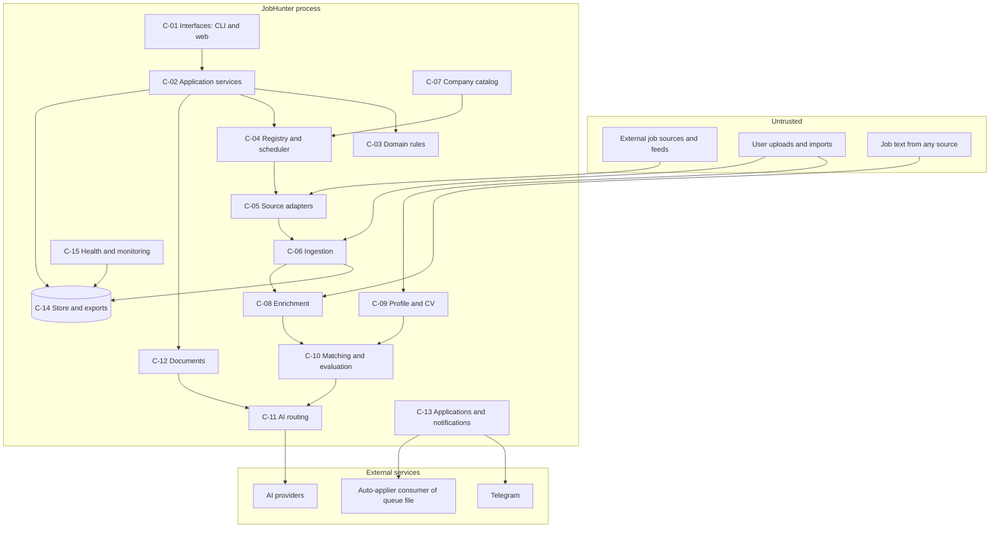

# 01 — Architecture Contract

## 1. Contract status

**Binding.** An implementation that violates a rule in §3 (invariants) or §6 (workflow contracts) is non-compliant regardless of tests passing.
* **Implementation conflicts with the architecture:** the implementation is changed, not the contract.
* **A developer wants to change the architecture:** file a proposal as a PCD (GOV-02 §9); do not implement it; the owner decides.
* **A requirement cannot be implemented as specified:** stop, record the finding, set the work package to `blocked` (GOV-04 §2), propose a PCD.
Source tags as in GOV-00.

## 2. Core architecture

Layers (DEC-003): **interfaces** → **application services** → **domain (pure rules)** → **adapters** (sources, AI, store, documents, notifications). Existing code (`agents/`, `utils/`, `scanners/`, `run_*.py`, `jobhunter_ui/`) remains and is wrapped (DEC-002). Two planes (DEC-037): a shared, user-independent plane (sources, runs, canonical jobs, enrichment, company catalog, scheduler) and a per-user plane (profile, eligibility, matching, feedback, documents, applications, private imports). Two modes (DEC-036): local single-user; hosted multi-user (staged, blocked by PCDs).

Hosted mode adds C-16 around the same services; it introduces no new business logic (DEC-036).

## 3. Architectural invariants

| ID | Invariant | Decision | Enforced by |
| -- | --------- | -------- | ----------- |
| INV-01 | Interfaces contain no business logic and import only application services and domain models | DEC-003 | G4 |
| INV-02 | No scoring constant, weight or threshold exists outside domain scoring | DEC-022 | G4, G15 |
| INV-03 | The LLM never sets, adjusts or defaults a score; scores come from deterministic code | DEC-022 | G16, WP-08-04 |
| INV-04 | A failed or partial AI step is stored as failed or partial; no fabricated or default result | DEC-034 | G16 |
| INV-05 | Documents are created only by DocumentService with a non-null user-action reference | DEC-019 | G5 |
| INV-06 | Original uploaded CV bytes never change; generated documents are new versions | DEC-020 | G5, WP-07-03 |
| INV-07 | No skill or language level is `confirmed` unless set by an explicit user action | DEC-021 | WP-07-01 |
| INV-08 | Contact data and nationality never enter AI payloads, logs or notification messages | DEC-045 | G12 |
| INV-09 | Ingestion never deletes jobs; every hidden job has a stored reason | DEC-024 | WP-05-03 |
| INV-10 | A job closes only after two consecutive complete, non-empty, successful runs; partial, failed, blocked, guarded and consumer-board runs never close or reopen | DEC-010 | G10 |
| INV-11 | A drop over 80 percent or to zero is re-baselined only after 8 runs over at least 24 hours and a passing health check | DEC-010 | G10 |
| INV-12 | A 401, 403 or 429 opens the host circuit breaker; no further request goes to that host in the window; no retry through another route | DEC-033 | G17 |
| INV-13 | Redirect and tracking links are never followed; robots.txt is honoured for non-API pages | DEC-033 | G17 |
| INV-14 | Every source carries access_basis, policy and redistribution; consumer providers and policy-disabled adapters cannot be enabled without a recorded owner acknowledgement | DEC-032, DEC-039 | WP-04-01, G17 |
| INV-15 | No endpoint is constructed except from a recognised (provider, identifier) or explicit configuration; no guessed or brute-forced names | DEC-029 | G17, WP-05-05 |
| INV-16 | Shared ingestion code contains no provider-name branching; one class per provider | DEC-007 | lint in WP-04-02 |
| INV-17 | Eligibility never alters the 0–100 match; unknown is never scored as failure | DEC-023 | WP-08-04 |
| INV-18 | Salary is never scored, converted or compared | DEC-025 | grep test in WP-08-02 |
| INV-19 | `global_id` is deterministic; a URL change never creates a new ATS job; no random identifiers | DEC-005 | G8 |
| INV-20 | The queue file is byte-identical for identical inputs; application_id hashing is unchanged | DEC-035 | G6 |
| INV-21 | After cutover the database is the only authority for an entity; legacy files are regenerated exports and are never read back (except by importers) | DEC-004 | WP-03-04, G13 |
| INV-22 | Every migration is additive and preceded by a verified backup | DEC-046 | G13 |
| INV-23 | Per-user data is reachable only through repositories that require a user context | DEC-036 | G18 |
| INV-24 | Only the scheduler-lease holder runs scheduled ingestion | DEC-028 | WP-02-05 |
| INV-25 | Mocked, simulated and designer-written results are labelled; verified requires a dated real run | DEC-047 | G9, G20 |
| INV-26 | Hosted mode never exposes personal_only or consumer-board data to another user | DEC-039 | G19 |
| INV-27 | The dependency lock contains no package outside the approved set and none on the block-list | DEC-013, DEC-015 | G3 |

## 4. Service boundaries

| Boundary | Input | Output | Data and security constraint |
| -------- | ----- | ------ | ---------------------------- |
| B1 User ↔ interfaces (user-controlled) | commands, form data, uploads | rendered Result | local mode binds 127.0.0.1; CSRF token on mutations; server text rendered as text only |
| B2 Interfaces → application services (trusted) | typed calls | `Result[T]` (status, data, errors, warnings) | no business logic above this line (INV-01) |
| B3 Services → domain (trusted, pure) | value objects | values | no I/O in domain |
| B4 Services → store (privileged) | repository calls with user context | rows | parameterised SQL only; additive migrations (INV-22) |
| B5 Adapters ↔ external sources (untrusted, external) | allow-listed hosts, https only | raw payloads | size and time caps; classify errors; breaker (INV-12); no redirects (INV-13) |
| B6 Imports and uploads (untrusted, user-supplied) | pasted text, .eml/.mbox, CSV, CV files | sanitised text and canonical jobs | HTML sanitised, no remote content, attachments ignored, links not followed, type and size validated |
| B7 Job text → enrichment and AI (untrusted content) | description text | structured facts with evidence quotes | text is data, never instructions; delimited; outputs schema-validated; every fact needs a verbatim quote |
| B8 Services → AI providers (external, sensitive) | minimised payload | validated structured output | no contact data or nationality (INV-08); CV text only under consent (DEC-045); keys by alias |
| B9 Services → Telegram (external) | job title, company, score, link | message | no personal data (INV-08) |
| B10 Queue file → auto-applier (external consumer) | file | none | byte-identical contract (INV-20); only ready_to_apply with approved documents |
| B11 Hosted: browser ↔ server (privileged, staged) | authenticated requests | per-user views | sessions, CSRF, rate limits; blocked until PCD-012 |
| B12 Hosted: tenant boundary (privileged, staged) | user context | scoped rows | INV-23, INV-26; operator access policy is PCD-022 |

## 5. Component contract

Responsibilities and the work packages that implement each component (generated from GOV-04):

| ID | Component | Responsibility | Implemented by |
| -- | --------- | -------------- | -------------- |
| C-01 | Interfaces (CLI and local web server) | Parse input, call exactly one service method, render Result[T]; no business logic | WP-01-01, WP-02-03, WP-02-04, WP-04-05, WP-07-04, WP-09-02 |
| C-02 | Application services | Use cases for profile, CV ingest, sources, discovery, jobs, match, evaluation, skill-gap, documents, applications, notifications, health | WP-02-01, WP-02-02 |
| C-03 | Domain (pure rules) | Scoring, eligibility, dedup, lifecycle and guards, profile-truth rules, salary and seniority rules; no I/O | WP-01-03, WP-02-01, WP-02-04, WP-04-04, WP-06-01, WP-06-02, WP-08-04 |
| C-04 | Source registry and scheduler | Source catalogue, states, policy gate, budgets, circuit breaker, cadences, single-writer lease | WP-01-05, WP-02-05, WP-04-01, WP-04-02, WP-12-02, WP-14-01, WP-15-02, WP-16-01 |
| C-05 | Source adapters | One class per provider behind the SourceAdapter contract; stateless; fetch and normalise only | WP-01-05, WP-04-02, WP-04-03, WP-05-01, WP-05-02, WP-11-01, WP-11-02, WP-11-03, WP-11-04, WP-11-05, WP-11-07, WP-11-09 |
| C-06 | Ingestion pipeline | Normalise, quality rules, visibility, Stage 1-2 dedup, persist raw and canonical jobs, lifecycle | WP-01-07, WP-05-03, WP-06-01, WP-06-02 |
| C-07 | Company catalog and recognition | Candidate pool, URL normaliser, resolver wrapper, policy gate, verification, tiers, entity resolution | WP-05-02, WP-05-05, WP-05-06, WP-11-06, WP-11-08 |
| C-08 | Enrichment | Language detection, EN/DE lexicons, sectioning, requirements, seniority, salary, eligibility cues, skill normalisation | WP-08-01, WP-08-02, WP-08-03, WP-08-06 |
| C-09 | Profile and CV ingestion | Versioned profile, proficiency provenance, work authorisation, upload validation, extraction, review defaults | WP-03-02, WP-07-01, WP-07-02, WP-07-03, WP-07-04 |
| C-10 | Matching and evaluation | Deterministic ScoreCard, eligibility verdict, optional validated LLM rationale, skill-gap | WP-01-02, WP-01-03, WP-08-04, WP-08-05, WP-08-06, WP-10-05 |
| C-11 | AI routing | Provider interface, model registry, error taxonomy, key pool, cache, cost log | WP-01-06, WP-08-05 |
| C-12 | Documents | Explicit per-job CV and cover-letter drafts, review, versioning, export, PDF | WP-01-01, WP-09-01, WP-09-02 |
| C-13 | Applications, notifications, feedback | Status machine, events, queue export, notification rules, feedback loop | WP-03-03, WP-10-01, WP-10-02, WP-10-03, WP-10-04 |
| C-14 | Store, migrations, exports | SQLite store, migrations, importers, compat exports, backups, verification | WP-00-01, WP-00-02, WP-00-03, WP-01-04, WP-03-01, WP-03-02, WP-03-03, WP-03-04, WP-10-02, WP-12-03, WP-13-02, WP-13-03 |
| C-15 | Health and monitoring | Run records, metrics, guards reporting, drift detection, diagnostics | WP-00-04, WP-04-04, WP-04-05, WP-12-01, WP-12-03, WP-12-04 |
| C-16 | Hosted platform layer | Accounts, sessions, tenant isolation, workers, object storage, compliance flows (staged) | WP-13-01, WP-13-02, WP-13-03, WP-14-01, WP-14-02, WP-14-03, WP-15-01, WP-15-02, WP-16-01, WP-16-02 |
| C-17 | Imports | Paste, .eml/.mbox, Telegram forward, CSV into the canonical job model | WP-05-04, WP-14-03 |

Contract details per component:

| Component | Inputs → outputs | Depends on | Prohibited behaviour | Invariants |
| --------- | ---------------- | ---------- | -------------------- | ---------- |
| C-01 Interfaces | user input → Result rendering | C-02 | business logic, direct file or DB access, scoring | INV-01, INV-02 |
| C-02 Application services | typed requests → `Result[T]` | C-03, C-14, adapters | duplicated rules, provider-specific code | INV-01, INV-23 |
| C-03 Domain | values → decisions | none | I/O, clocks without injection, randomness | INV-02, INV-10, INV-11, INV-17, INV-18 |
| C-04 Registry and scheduler | source config → permitted runs | C-14, C-05 | enabling without acknowledgement; second scheduler | INV-12, INV-14, INV-24 |
| C-05 Source adapters | query and checkpoint → raw batches, normalised Jobs | RunContext only | sleeping, retrying or writing to the DB themselves; following redirects | INV-12, INV-13, INV-15, INV-16, INV-19 |
| C-06 Ingestion | batches → canonical jobs, sightings, links | C-03, C-14 | deleting jobs; closing on partial runs | INV-09, INV-10 |
| C-07 Company catalog | candidates → verified sources | resolver, C-04 | guessing endpoints; polling before the policy gate | INV-15, INV-14 |
| C-08 Enrichment | text → facts with quotes | lexicons | unquoted facts; scoring salary | INV-18, INV-17 |
| C-09 Profile and CV | edits and files → versions | C-14 | auto-confirming levels; modifying originals | INV-06, INV-07, INV-08 |
| C-10 Matching and evaluation | profile and job facts → ScoreCard, verdict | C-03, C-11 | LLM-set scores; eligibility in the score | INV-03, INV-17 |
| C-11 AI routing | task and schema → validated output or failure | providers | fabricated results; retrying permanent errors | INV-04, INV-08 |
| C-12 Documents | job and profile and action → drafts | C-10, C-11 | creating without a user action | INV-05, INV-06 |
| C-13 Applications, notifications, feedback | events → states, messages, suggestions | C-14 | personal data in messages; auto-hiding on feedback | INV-08, INV-20 |
| C-14 Store and exports | repository calls → rows and files | none | destructive migrations; reading exports back | INV-21, INV-22 |
| C-15 Health and monitoring | runs → status, alerts | C-14 | hiding failures; alerting on small boards without the rule | INV-10, INV-25 |
| C-16 Hosted layer | requests → scoped services | C-02 | new business logic; cross-tenant access | INV-23, INV-26 |
| C-17 Imports | user content → canonical jobs | C-06 | following links; storing recruiter e-mails | INV-13, INV-08 |

## 6. Data-flow rules

| Data | Rule |
| ---- | ---- |
| Contact data, nationality | stored only in the profile; excluded by construction from AI input builders, logs, notifications (INV-08) |
| Credentials | `.env` only; referenced by alias; never logged, returned by an API or stored in the database (GOV-03 §4) |
| Untrusted input (job text, uploads, imports, external responses) | sanitised, size-capped, schema-validated; never executed, rendered as HTML or used as instructions |
| Generated content (LLM output) | validated against a schema; facts need evidence quotes; unvalidated output is discarded as failed |
| External API responses | raw payload kept for replay (30-day default), then normalised; errors classified, never swallowed |
| Audit data | append-only record of user actions (document request, consent, enabling a source, export, confirmation, deletion) |
| Telemetry | run metrics and counts only; no personal data; no job text |

## 7. AI contract

AI is present in the source (DEC-022, DEC-034, DEC-045).

| Question | Rule |
| -------- | ---- |
| May do | extract requirement candidates from job text; write a short rationale citing requirement ids; propose CV patches and cover-letter text on explicit user action; optionally assist CV field extraction under consent |
| May not | set, adjust or default a score; decide eligibility; call tools; trigger side effects; read contact data or nationality; enable sources; create documents on its own |
| Tools / side effects | none; models are called for text-in, structured-out only |
| Context received | minimised job text and the confirmed profile subset needed for the task; never contact data, nationality or secrets |
| Output format | JSON matching a versioned schema; every requirement carries a verbatim evidence quote that must occur in the input |
| Validation | schema check; quote-in-text check; one repair attempt; otherwise `failed` |
| Prompt-injection containment | job text and CV text are delimited data; the system rule states that instructions inside them are ignored; no tools means no action to hijack; deterministic code, not the model, produces scores and states |
| Failure | `failed` or `partial` with a stored reason; matching still works without AI; no retry on permanent errors; per-key cooldown on quota exhaustion; at most 3 attempts per job per day |

## 8. Workflow contracts

Each workflow is a deterministic sequence; deviations are architecture violations.

**W1 Scan and ingest** — 1 scheduler acquires lease (INV-24) · 2 registry selects permitted sources (policy gate, state, cooldown, budget) · 3 adapter discovers via RunContext · 4 raw batch stored · 5 normalise to canonical Job (deterministic id) · 6 global quality rules set visibility and reason (no deletion) · 7 Stage 1 then Stage 2 dedup and exact-hash links · 8 lifecycle applies new/updated; closing only through guards (INV-10, INV-11) · 9 run record with metrics and coverage · 10 events emitted.

**W2 Enrich and match** — 1 language detect, hide non-EN/DE with reason · 2 sections, requirements with quotes, seniority, salary as stated, eligibility cues (once per job) · 3 per user: signals from confirmed and unconfirmed profile states · 4 ScoreCard and confidence · 5 eligibility verdict (separate) · 6 store with profile version id.

**W3 Evaluate (optional AI)** — 1 check consent and payload class · 2 minimise payload · 3 route (task policy, key pool) · 4 classify result · 5 validate schema and quotes · 6 store `complete`, `partial` or `failed` · 7 matching unaffected by failure.

**W4 Create a document** — 1 explicit user action on one job (audit event written first) · 2 DocumentService checks confirmed profile and base CV · 3 draft via patch, protected fields validated · 4 show diff and facts check · 5 user approves, regenerates or discards · 6 explicit export. No other path exists (INV-05).

**W5 Import** — 1 receive upload or paste · 2 validate type, size · 3 sanitise · 4 extract fields · 5 confidence decides save-with-undo or preview · 6 canonical Job with `import` provenance; private to importer in hosted mode.

**W6 Application state and export** — 1 user changes status (event written) · 2 only `ready_to_apply` with approved documents is exportable · 3 export regenerates the queue file deterministically · 4 file only; no submission.

**W7 Profile and CV intake** — 1 validate file · 2 store original read-only by hash · 3 rules-based extraction · 4 auto-accept high confidence as unconfirmed with undo · 5 user edits create a new version · 6 only the user may confirm a level.

**W8 Source activation** — 1 candidate recognised by the resolver · 2 policy gate · 3 `health_check` and capped first fetch · 4 `validating` · 5 fixtures green plus one canary run → `active` · 6 breaker or guard failures → `degraded` or `blocked`.

**W9 Migration and cutover** — 1 verified backup · 2 additive migration · 3 importers (idempotent) · 4 verification (counts, URL sets, application_id, byte-identical queue) · 5 authority flag per entity · 6 rollback by flag.

## 9. Determinism and replay

* **Stable identifiers:** `global_id = ats_type:ats_id` or a hash of the canonical URL; never random (INV-19). UAA `application_id` hashing unchanged (INV-20).
* **Versions:** profile versions, `job_version` content hashes, document versions, scorer version and prompt version are stored with every derived row.
* **Replay:** raw payloads are retained so parsers can be re-run; re-running an ingest or importer is idempotent; matching results record the profile version used and are marked stale when it changes.
* **Idempotency:** unique keys on (source, external id), (job, source, url), (notification dedupe key), (job, kind, version).
* **Caching:** AI results cached by (task, prompt version, text hash, profile snapshot id).
* **Ordering:** events carry timestamps and monotonic ids; lifecycle decisions depend only on stored run records, not on wall-clock ordering of concurrent runs (single scheduler lease).
